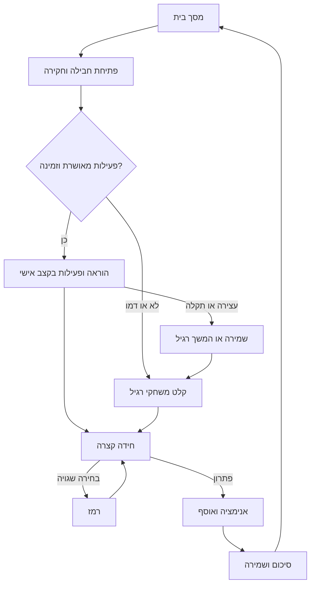
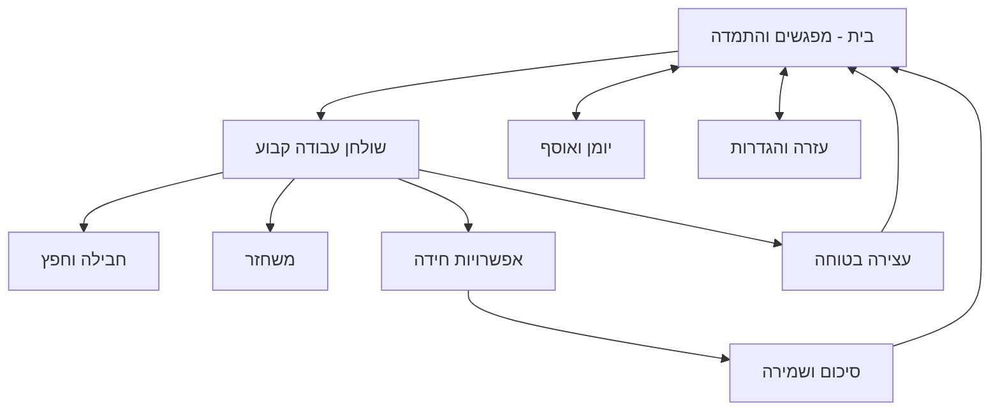

# OralQuest — עולם הדברים האבודים

**Tagline:** לכל דבר שאבד יש סיפור. לאן יוביל הסיפור שלך?

**חברת הצוות:** עדי פלצקי  

## מהות המשחק

**OralQuest** הוא משחק חידות פנטזיה בתלת־ממד לשחקן יחיד, המתרחש במשרד האבידות של היקום. בכל מפגש קצר השחקן מקבל אבידה מסתורית, חוקר מה היא איבדה, מפעיל עליה יכולות באמצעות פעילות אורו־מוטורית שנבחרה עבורו (או קלט רגיל במצב הדגמה), פותר חידה קצרה ומוסיף את החפץ המשוחזר לאוסף האישי. מערכת התמדה מציגה את ההתקדמות היומית, רצף אישי ושיאים, בהתאם לתוכנית ולא לכמות או למהירות התנועות.

**הסיפור:** יום אחד מופיע בכיסו של השחקן מפתח זר. כשהוא נוגע בו, נפתחת דלת למשרד האבידות של היקום. פקיד משונה שאינו זוכר את שמו מציע לשחקן לעזור בטיפול בחבילות המגיעות למשרד. בין דפי ספר האבידות מופיע גם שמו של השחקן, ללא הסבר. כל אבידה משוחזרת עשויה לחשוף רמז קצר לתעלומה. פתרון התעלומה הסופי יגובש בתכנון העלילה.

**חוק הפנטזיה המרכזי:** בעולם הזה לא רק חפצים הולכים לאיבוד — גם התכונות שלהם. שעון יכול לאבד את הזמן, מראה את ההשתקפות, נורה את האור ומטרייה את הגשם. החזרת התכונה יוצרת תגובה מפתיעה, למשל מטרייה שממטירה גשם דווקא מתחתיה. חוקי החידה מוצגים ברמזים עקביים; הפתעה חזותית אינה תירוץ לפתרון שרירותי.

**המכניקה המרכזית:** גילוי, התאמה והחזרת תכונות אבודות. כלי קסום אחד, ״המשחזר״ (The Restorer), מספק מסגרת קבועה; כל חפץ מגיב באופן שונה לפקודת הפעלה משותפת. שלוש וריאציות תוכן: התאמה, שילוב וסידור.

**עמודי התווך:** התמדה — חזרה בהתאם לתוכנית אישית; סקרנות — איזו אבידה תגיע ומה יתגלה; סיפוק — לראות את השינוי בחפץ ולאסוף את הסיפור שלו.

**פלטפורמה:** Windows, Unity 3D / C#, מצלמת רשת בשלב בדיקת היתכנות, עכבר ומקלדת באב־טיפוס. סביבה תלת־ממדית קטנה אחת, מצלמה קבועה וממשק Point & Click. אין VR, עולם פתוח, חנות, מטבעות, אויבים או פיזיקה מורכבת ב־MVP.

**ז'אנר:** Casual Puzzle Adventure, Point & Click, Collection, Serious Game.

**מטרה שיקומית מתוכננת:** תמיכה בהשתתפות ובהתמדה בתרגול ביתי שהוגדר אישית בידי קלינאית תקשורת. הנחת תכנון חדשה, לפי דיווח המפתחת: כשלושה מפגשים קצרים ביום לפני הארוחות, מחולקים לסטים מוגבלים. זו אינה הוראה רפואית כללית, אינה מסקנה מוכחת מהראיון, וטעונה אימות מקצועי. מספר המפגשים, חלונות הזמן, הפעילויות, הסטים, החזרות, משכי ביצוע ומנוחות יוגדרו בתוכנית אישית. אין לתרגל בזמן אכילה או עם מזון בפה. אין ברירות מחדל טיפוליות; אב־טיפוס הקורס עובד בקלט מדומה בלבד עד לבדיקות ואישורים מתאימים.

## רכיבים רשמיים

### 1. שחקנים (Players)

קהל היעד הראשוני הוא מבוגרים בני 18 ומעלה לאחר שבץ, שנמצאו מתאימים מקצועית לפעילות אורו־מוטורית גלויה נבחרת ויכולים להשתמש במחשב בעצמם או עם מלווה. מיקוד בקושי קל–בינוני בתנועה הנבחרת הוא הנחת תכנון בלבד ולא סיווג רפואי. לא כל אדם לאחר שבץ או עם דיספגיה מתאים. שיקום דיבור אינו נובע אוטומטית מתנועות פה שאינן דיבור.

**מספר שחקנים ואינטראקציה:** שחקן יחיד מול המערכת; מלווה רשאי לסייע בהפעלת ממשק ובהבנת הוראות.

**נגישות וניסיון:** מתאים גם למי שלא שיחק מעולם. כפתורים גדולים, פעולה אחת בכל רגע, טקסט קצר, סמלים עם תוויות, אפשרות הקראה, עזרה בכל מסך, תמיכה ביד אחת והפחתת אנימציות. אין חידה התלויה רק בצבע או בשמע, אין צורך בגרירה מדויקת או לזכור מידע ממפגש קודם. רמזים מוצגים מחדש לפי צורך. רמת המשחק ניתנת להתאמה בנפרד מהתוכנית הקלינית.

**דוגמת משתמש:** מבוגר לאחר שבץ שפעילות שפתיים גלויה מתאימה לו, פותח את המשחק לפני מפגש שנקבע לו ומקבל הוראה אחת והדגמה. אם מתעייף, הוא יכול לעצור בלי לאבד את החפץ או ההישגים.

### 2. יעדים (Objectives)

**מטרה משחקית במפגש:** לזהות את התכונה שאבדה, לפתור את החידה ולהשיב אותה לחפץ. השינוי החזותי הוא משוב מיידי; החפץ מקבל רשומה ביומן.

**מטרה ארוכת טווח:** להרחיב את אוסף האבידות, לגלות רמזים על הופעת השחקן בספר האבידות ולפתור את תעלומת המשרד. תוכן ואוסף נשמרים גם אחרי הפסקות. סיום פרק אינו תלוי ברצף או בביצוע קליני.

**מטרה טיפולית:** השתתפות בגבולות התוכנית האישית, לא שיפור ציון על מהירות, כוח או כמות. סיום מפגש לפי התוכנית ופתרון חידה הם שני אירועים שונים. שום תוצאה במשחק אינה הוכחה לשיפור רפואי.

**הצגת יעדים:** מסך בית מציג מפגשים מתוכננים להיום, רצף ושיא אישי (ניתנים להסתרה), כפתור למפגש הבא, יומן ועזרה. במסך עבודה מוצגת מטרה אחת, למשל ״מצאו את התכונה שאבדה לנורה״; בזמן הפעילות מוצגת הוראה אחת ומד התקדמות בסטים לפי התוכנית בלבד. בסיום מוצגים גילוי, סטטוס פעילות ואפשרות יציאה.

### 3. תהליכים (Procedures)

**30 השניות הראשונות — תזמון המחשה בלבד, לא מגבלת תגובה:**

- 0–5: מפתח זר מופיע והדלת למשרד נפתחת.
- 5–12: הפקיד מקבל את פני השחקן, מציג חבילה וכפתור ״פתחו את החבילה״.
- 12–22: נורה שאינה מאירה נחשפת. מוצגת פעולה מודרכת בקלט מדומה (לחיצה אחת); המשחזר מגיב באפקט אור.
- 22–30: השחקן בוחר בסמל האור המודגש, הנורה נדלקת ונוספת ליומן. מוצג כפתור חזרה. המשחק ממתין בכל צעד; אין טיפול לפני הגדרה וכיול.

**לולאת המשחק בכל מפגש:**

1. מסך בית → בחירת מפגש מתוכנן או משחק רגיל. המערכת טוענת את ההתקדמות ואת החפץ הנוכחי. באב־טיפוס מוצגת תוכנית דמה המסומנת כהדגמה בלבד.
2. פתיחת חבילה בלחיצה וחקירת החפץ באמצעות תגובה חזותית ורמז קצר.
3. הפעלת המשחזר: במצב מאושר נבדקים תוכנית תקפה, חלון זמן, מכסה, מנוחות, כיול ואיכות קלט. כל אירוע מזוהה תקף יכול להפעיל תגובה חזותית קצרה בהתאם למשימה; אין דרישה להפעיל את כל סוגי התנועות. מסך הוראה נפרד מאפשר עצירה בכל שלב.
4. לאחר הפעילות או במצב לא־טיפולי, מוצגות אפשרויות התכונה. בוחרים באמצעות עכבר/מקלדת; תשובה שגויה מציגה רמז ולא מחייבת חזרה פיזית.
5. פתרון נכון או מודרך משחזר את החפץ, מפעיל אנימציה קצרה ומוסיף אותו פעם אחת ליומן. נחשף פרט עלילתי לפי סדר התוכן.
6. סיכום ושמירה: התקדמות משחקית וסטטוס השתתפות נשמרים בנפרד; חזרה לבית, יציאה או צפייה באוסף. אם הושגה המכסה, אין פתיחת תרגול נוסף. תוכן משחקי נשאר נגיש בקלט רגיל.

*איור 1. תרשים לולאת המשחק המתוכננת; אינו צילום מוצר פעיל.*

**הקשר בין רמה, מפגש וסט:** רמה היא מורכבות משחקית; מפגש הוא יחידת תזמון אישית; סט הוא קבוצת פעילויות לפי הגדרה קלינית. חידה אינה שווה סט. אותו תוכן מתאים למספר שונה של סטים; מפגש שנקטע יכול להישמר והמשך פעילות מותנה בתוכנית, ללא חובות או השלמה כפולה. שחקן יכול להתקדם בחידות ללא תרגול נוסף. תזמון חלונות מנוחה ומפגשים לא נקבע על פי רמת המשחק.

**פקדים:** לחיצה לבחירה/הפעלה; Tab ו־Enter או Space במצב דמו, Esc וכפתור עצירה בולט. קלט משחקי נפרד מקלט פעילות. מועמדי בדיקת מצלמה: `jawOpen`, `mouthPucker`, `mouthSmileLeft/Right`; בפיתוח ייבדק תחילה מועמד אחד בלבד. הפלט אינו מדד לכוח, איכות בליעה, מנח לשון או הצלחה רפואית. אירוע הפעלה כללי מאפשר להחליף קלט בלי לשנות חידה.

**דוגמה:** מטרייה נפתחת וענן נעלם. המשחזר חושף שתי אפשרויות: גשם ורוח. הרמז ״לא ירדה אפילו טיפה״ מסביר את הבחירה. בחירת גשם משיבה תכונה והמטרייה ממטירה תחתיה. בחירה אחרת מציגה רמז; אין צורך לבצע שוב תרגיל כדי לתקן תשובה.

**סיום הקמפיין:** לאחר פתרון רצף החידות המרכזיות מתגלה פשר הרישום של השחקן בספר האבידות. סיום הקמפיין הוא סיום עלילתי בלבד; ניתן לצפות שוב בחפצים ולשחק בחידות ללא פעילות פיזית.

### 4. חוקים (Rules)

- לחידה פתרון מוגדר ורמז שמאפשר להסיק אותו. בחירה שגויה הפיכה, ללא איבוד חיים, מטבעות או ניקוד. רמז ופתרון מודרך זמינים בכל רמה.
- כל הפעלה טיפולית דורשת תוכנית מקצועית, התאמה אישית, כיול תקף ותנאי זיהוי. אין תרגול טיפולי באב־טיפוס המדומה. ללא תוכנית אין הפעלה טיפולית.
- המערכת מכבדת מספר מפגשים, מכסה לכל פעילות/סט, משך ומנוחות; אינה מציגה הזמנה לחזרות נוספות ואינה מקצרת מנוחה לשם הישג. אירוע קלט אחד נצרך פעם אחת; תנועה רציפה לא יוצרת חזרות כפולות. תנאי קצב וזיהוי יוגדרו רק לאחר אישור מקצועי ותיקוף.
- אם יש כאב, עייפות, אי־נוחות, חוסר זיהוי או הפסקה — עצירה, עזרה או המשך רגיל. אין הנחיה להתאמץ יותר ואין פיצוי על פעילויות שהוחמצו. אי אפשר להבטיח שהמשתמש אינו מתרגל מחוץ למשחק; החסימה חלה על הנחיות ותיעוד בתוך המערכת.
- פתיחת המשחק, קלט מדומה או פתרון חידה אינם השלמת תרגול. נשמרים בנפרד אירועי זיהוי, סטטוס מפגש ותוצאה משחקית; אין להסיק מהם תוצאה קלינית. זיהוי לא ודאי אינו הצלחה וגם אינו כישלון של המטופל.
- חפץ מתווסף פעם אחת לפי מזהה ייחודי; צפייה חוזרת או חזרה על חידה אינה מחייבת פעילות נוספת.
- אין מגבלת זמן לפתרון חידה; מגבלות זמן פעילות שייכות לתוכנית הקלינית בלבד. כל פעולה ניתנת לעצירה.

**כללי התמדה — מפרט מוצר מוצע:**

| מדד / מצב | כלל |
|---|---|
| התקדמות יומית | מספר המפגשים שהושלמו לפי תנאי התוכנית מתוך אלו שנקבעו להיום; לא מספר כניסות או תנועות |
| רצף נוכחי | נספר יום מתוכנן שהושלם, פעם אחת בלבד; יום מנוחה מאושר/הפסקה בטוחה/תקלה לא מוסיף יום ואינו שובר את הרצף כאשר סווג כפטור. יום שהוחמץ ללא פטור מסיים את הרצף, ללא עונש אחר |
| שיא אישי | המקסימום של הרצף שנצבר; אינו יורד |
| התמדה מצטברת | ימי השתתפות/השלמה מתועדים לאורך זמן; לא מתאפסים כאשר הרצף מסתיים |
| מפגש חלקי/לא מאומת | מוצג ככזה, לא נספר כהשלמה אוטומטית. עצירה בטוחה ומצב פטור נפרדים מהצלחה טיפולית |
| תרגול חוזר | מזהה מפגש ייחודי ותיעוד עמיד מונעים ספירה כפולה בפתיחה מחדש; אין צבירת חובות או איפוס מכסה עקב מעבר רמה |
| נגישות ומוטיבציה | אפשר להסתיר את הרצף, ללא קנייה של הגנת רצף, דירוג, הודעות מאשימות או תגמול על השלמה מהירה |

סיווג מפגש/יום כפטור והגדרת ״השלמה״ יתואמו עם קלינאית; עד אז משתמשים בנתוני דמו בלבד. תזכורות עתידיות הן אופציונליות, בהתאם לתוכנית, ולא בזמן לא מתאים. אין לקשור את פתיחת הסיפור לרצף מושלם או למדד טיפול. דוגמה: מטופל עם שלושה מפגשים מתוכננים השלים שניים והפסיק בבטחה את השלישי; הממשק מציג 2/3 והפסקה, שומר על החפצים ומאפשר פטור ללא ספירת יום כהשלמה.

### 5. משאבים (Resources)

| משאב | כיצד משיגים | שימוש | נדירות/מגבלה |
|---|---|---|---|
| אבידה משוחזרת | פתרון חידה (גם מודרך או בקלט רגיל) | אוסף, צפייה חוזרת בסיפור ובאנימציה | רשומה ייחודית לכל חפץ; אין שכפול |
| תכונות אבודות | בחירה מתוך אפשרויות שמוגדרות בחידה | התאמה, שילוב או סידור | זמינות רק בחידה הרלוונטית; אינן מטבע |
| רמזי סיפור | השלמת חידות מפתח | התקדמות בתעלומת הספר | נפתחים לפי סדר תוכן; נשמרים ביומן |
| הישגי התמדה | אבני דרך אישיות בהתאם לתוכנית | משוב אישי, סמל ביומן ההישגים | פעם אחת לכל אבן דרך; אין יתרון קליני או פתיחת תוכן הכרחי |

**דוגמה למחסור:** בפרק הדגמה ארבע חידות וארבע רשומות ייחודיות. נורה משוחזרת אינה מופיעה פעמיים באוסף גם אם פותרים שוב את החידה. אין חנות, מטבעות, חיים מתכלים או רכישות לשיפור ביצוע.

### 6. עימותים (Conflict)

**שחקן מול המערכת:** חפץ בעל תכונה חסרה, מידע חלקי ובחירה בין פתרונות. המתח נובע מהסקרנות ומהפתרון, לא מאויב, נפילה או לחץ זמן. למשל, להבין איזה סדר יום ולילה מחזיר זמן לשעון לפי רמז.

**שחקן מול עצמו:** רצון להרחיב את האוסף, לגלות מה בחבילה הבאה ולהתקדם בהתמדה בהתאם לתוכנית. השיא האישי הוא אפשרות למשוב ולא חובת ביצוע; אין השוואה מוטורית ואין לחץ להשלים כשלא מרגישים טוב.

### 7. גבולות (Boundaries)

סביבת המשחק היא משרד תלת־ממדי קטן עם שולחן עבודה, מקום לחבילה, משחזר, אזור אפשרויות ומדף אוסף. מצלמה קבועה; אינטראקציות באמצעות נקודות לחיצה. אין תנועה חופשית של דמות או מעבר לעולמות פיזיים שונים. גבולות טבעיים הם שולחן, קירות ומדפים; רכיבים לא פעילים מוצגים כקישוט. הממשק מאפשר מעבר למסך בית, יומן, עזרה וסיכום בלבד; מצב עצירה נגיש בכל מסך.

*איור 2. תרשים מסכים ואזורי אינטראקציה; לא מפה במידות Unity.*

**רמות קושי — מסגרת מוסכמת לתכנון הבא:** ארבע רמות לפחות באותה סצנה ובאותו מנגנון. המספרים מתייחסים לחידה ולא לתרגילים. דוגמאות החפצים הן כיוון תוכן; המיקומים והפתרונות המלאים ייקבעו במסמך Level Design.

| מאפיין | Tutorial | Easy | Medium | Hard |
|---|---|---|---|---|
| דוגמה | נורה שאיבדה אור | מטרייה שאיבדה גשם | מראה וצל | שעון שאיבד יום ולילה |
| חפצים מרכזיים | 1 | 1 | 2 | 3 |
| אפשרויות בחירה מרביות בנקודה | 1 | 2 | 3 | 4 |
| שלבי פתרון | 1 | 1 | 2 | 3 |
| מכניקה | הדגמה מודרכת | התאמה | שילוב | סידור/סדר פעולות |
| רמז | אוטומטי | גלוי | זמין | זמין |
| מגבלת זמן לחידה | אין | אין | אין | אין |
| מינון פעילות | אישי | אישי | אישי | אישי |

כל רמה תקבל תרשים מפורט, קואורדינטות, מיקומי UI, מצבי אובייקטים, רמזים, פתרון ובדיקות קבלה. פתיחת רמות קשורה ללימוד המשחק, לא ליכולת קלינית; ניתן לבחור עזרה או רמה פשוטה יותר.

### 8. תוצאות (Outcomes)

**תוצאות משחק:** פתרון עצמאי, פתרון מודרך או שמירה להמשך. בחירה שגויה אינה הפסד; מצב רגיל מאפשר אותה התקדמות עלילתית. חזרה על פרק אינה משכפלת חפצים.

**תוצאות פעילות:** מפגש שהושלם לפי כללים אישיים, מפגש חלקי, עצירה בטוחה או סטטוס לא מאומת/תקלה. אין הגדרה אוטומטית של שיפור קליני. מסך הסיכום מציג את הסטטוסים בנפרד; אין אובדן אוסף או שיא היסטורי.

**סיום המשחק:** פתרון התעלומה ואוסף האבידות שהושגו; אפשר לצפות שוב בתוכן ולהמשיך בפעילות משחקית. אין הפסד בלתי הפיך. המשחק יחידני ואינו סכום אפס; הצלחה מבוססת על הבנת רמזים ולא מזל. הפתעות בחבילה ובאנימציה הן תוכן, לא שינוי אקראי בתנאי פעילות או פתרון חובה.

---

## סקירת משחקים קיימים

הסקירה נשענת על המחקר המקורי מ־17.11.2026 ועל ההרחבה מ־24.11.2026. נוספו מקורות רשמיים למנגנוני התמדה ולמשחקי חידות חפצים. לא בוצעה סקירת פטנטים או הוכחה לעליונות.

| משחק / מערכת | מה קיים | מה נלמד ומה מבדל את OralQuest |
|---|---|---|
| FR-VG | משחקי תרגול פנים/פה, פיילוט לאחר שבץ | מתחרה טכנולוגי ישיר; תרגול בתוך חידות קצרות ואוסף הוא הבידול המוצע |
| PaTaKaRUSH | זיהוי הברות, שלבים וניקוד | משוב והתקדמות; OralQuest אינו מבוסס על מהירות הגייה או דירוג |
| SilverFit Rephagia | משוב sEMG ובחירת תרגילים מקצועית | התאמה אישית; מצלמה אינה תחליף למדידת פעילות שריר |
| Mobili-T | תרגול בליעה ביתי עם חיישן ומעקב | רציפות טיפולית; המוצר שלנו מציע חידות ופעילות מוגדרת ולא מדידת בליעה |
| Forgotton Anne | עולם חפצים אבודים שקיבלו חיים | חפיפה תמאטית; הבידול המוצע הוא תכונות שאבדו, משרד קבוע וחידות התאמה, לא פלטפורמינג |
| Lost and Found Co. | חיפוש חפצים אבודים ועזרה לדמויות | השראה לסקרנות; אנחנו משחזרים תכונה חסרה ולא רק מחפשים פריט |
| Duolingo | מפגשים קצרים, רצף ימים ויעדים נפרדים | השראה להתמדה; ללא תחרות, קניית הגנת רצף או הגדלת מינון |
| A Little to the Left | סידור חפצים וחידות קצרות | השראה לפעולות פשוטות וסיפוק; אצלנו השחזור והתרגול האישי מחוברים לסיפור |
| Assemble with Care | סיפור סביב תיקון חפצים | חפיפה למכניקת שחזור; אצלנו תכונות פנטסטיות במקום פירוק מכני מפורט |
| Monument Valley | חידות וסביבות בעלות גאומטריה בלתי אפשרית | השראה לחוקי פנטזיה עקביים; ללא מימוש גאומטריה או ניווט מורכבים |

**קישורים לצילומי מסך, דוגמאות ומקורות רשמיים:**

- [FR-VG — מאמר ומסכי המחקר](https://pmc.ncbi.nlm.nih.gov/articles/PMC10655413/)
- [PaTaKaRUSH — אתר היצרן](https://www.icatcorp.jp/pro/patakarush.html)
- [Tongue Muscle Training App — מאמר ואיורים](https://pmc.ncbi.nlm.nih.gov/articles/PMC11737528/)
- [SilverFit Rephagia — אתר היצרן](https://www.silverfit.com/en/systems/silverfit-rephagia/)
- [Mobili-T — App Store](https://apps.apple.com/us/app/mobili-t/id1247584742)
- [Forgotton Anne — Steam](https://store.steampowered.com/app/542050/)
- [Lost and Found Co. — Steam](https://store.steampowered.com/app/2101390/)
- [Duolingo — תיאור רצף ויעדים](https://blog.duolingo.com/improving-the-streak/)
- [A Little to the Left — Steam](https://store.steampowered.com/app/1629520/)
- [Assemble with Care — ustwo games](https://ustwogames.co.uk/our-games/assemble-with-care/)
- [Monument Valley — ustwo games](https://ustwogames.co.uk/our-games/monument-valley/)

**צילומי מסך להשוואה (ממקורות הסקר המקורי):**

*איור 3. PaTaKaRUSH, אתר iCAT; צילום מסך של המתחרה, לא של OralQuest. זכויות התמונה שמורות לבעליה.*

*איור 4. Su et al., JMIR Serious Games, 2025, איור 2 (CC BY 4.0), לפי הקרדיט במסמך המקורי. שני הקישורים החיצוניים נשמרו מהאפיון המקורי וזמינותם תלויה באתרי המקור.*

**הרכיבים הפורמליים שמדגישים מקוריות:** יעדים — שחזור תכונה ותעלומה; תהליכים — אותה פקודת הפעלה מגיבה אחרת לכל חפץ; חוקים — הפרדה בין תרגול לחידות; משאבים — אוסף ורמזים ללא כלכלה; תוצאות — רצף אישי ללא תרגול־יתר והמשך עלילתי גם ללא קלט קליני. השילוב הוא השערת בידול ולא טענה לראשוניות.

## היקף פיתוח ובקרת התאמה

אב־טיפוס ראשון: סצנה אחת, חפץ אחד, משחזר, בחירה, אנימציה, אוסף ושמירה מקומית של נתוני דמו. לאחר שהלולאה עובדת, ארבע חידות, מסך מפגשים ומנגנון התמדה מדומה. רק אחר כך בדיקת תנועת מצלמה אחת בכפוף לאישור. מבנה מוצע: `GameManager`, `SessionManager`, `InputManager`, `PuzzleManager`, `LostObject` (נתוני ScriptableObject), `StreakManager`, `CollectionManager`, `SaveManager`. ניתן לממש בשלבים ולא נדרשות שמונה מערכות מורכבות מראש. אין שמירת וידאו או מידע רפואי באב־טיפוס הציבורי. איורים ותרשימים הם המחשות תכנוניות, לא צילומי מסך של מוצר פעיל.

| דרישת המטלה | מענה |
|---|---|
| שם, tagline, מהות, ז'אנר ופלטפורמה | פתיחת המסמך |
| שחקנים ויעדים | סעיפים 1–2 |
| תהליכים, פקדים, 30 שניות ראשונות | סעיף 3 ותרשים לולאה |
| חוקים ומשאבים | סעיפים 4–5 |
| עימותים, גבולות ותוצאות | סעיפים 6–8 ותרשים מסכים |
| סקירת משחקים קיימים, קישורים ובידול | פרק סקירת משחקים |
| התאמה לקהל היעד ולמחקר | לאורך המסמך; [Clinical_Needs_Analysis.md](Clinical_Needs_Analysis.md) |

**יחס למסמכים קודמים:** מסמך זה מחליף את אפיון הריצה ואת גרסת אזורי החקר. דוגמת המסלול שבמסמך המחקר הקליני הישן מוחלפת בשולחן ובמשחזר; ממצאי המחקר עצמם אינם משתנים. הנחת שלושת המפגשים היא מידע חדש שדורש אימות; אין להציג אותה כממצא מהראיון המקורי. פירוט בסקר השוק המעודכן [Market_Research.md](Market_Research.md).

