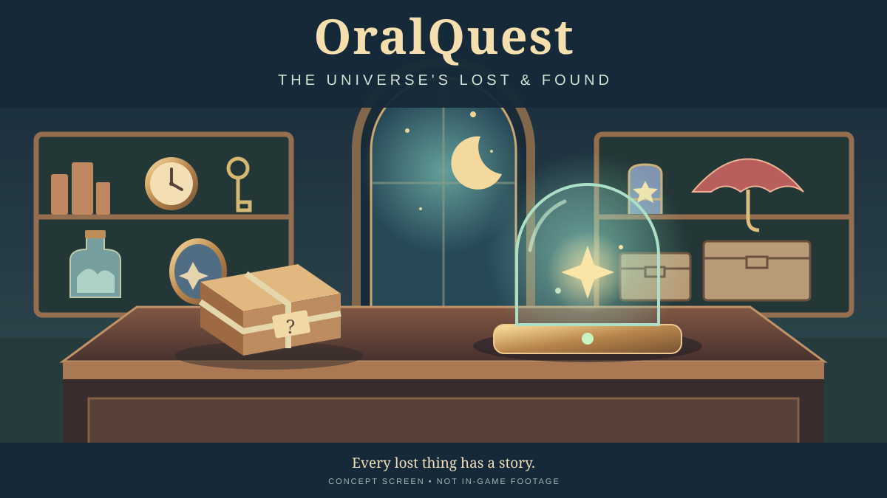

# OralQuest — עולם הדברים האבודים

**לכל דבר שאבד יש סיפור. לאן יוביל הסיפור שלך?**

*המחשה רעיונית למסך הפתיחה, לא צילום מתוך משחק פעיל.*

## על המשחק

**OralQuest** הוא משחק חידות פנטזיה קליל בתלת־ממד לשחקן יחיד, המתרחש במשרד האבידות של היקום — מקום שאליו מגיעים לא רק חפצים אבודים, אלא גם התכונות שאיבדו: שעון שאיבד את הזמן, מראה שאיבדה את ההשתקפות שלה ונורה שאיבדה את האור.

בכל מפגש קצר השחקן פותח חבילה מסתורית, חוקר את האבידה, מפעיל את המשחזר הקסום, פותר חידה ומחזיר לחפץ את התכונה החסרה. החפץ מצטרף לאוסף האישי, וההתקדמות חושפת רמזים לתעלומה: מדוע שמו של השחקן מופיע בספר האבידות?

המשחק נועד לתמוך בהתמדה בתרגול אורו־מוטורי ביתי שנבחר אישית על ידי קלינאית תקשורת, תוך שמירה על חוויית משחק פשוטה, נעימה ונגישה. קהל היעד הראשוני הוא מבוגרים לאחר שבץ שנמצאו מתאימים לפעילות שנבחרה עבורם.

## מה מייחד את המשחק?

- **פנטזיה וחידות קצרות:** גילוי, התאמה, שילוב וסידור של תכונות אבודות.
- **התמדה אישית:** מעקב אחר מפגשים מתוכננים, רצפים ושיאים אישיים, ללא תגמול על מהירות או תרגול־יתר.
- **אוסף מתפתח:** כל אבידה משוחזרת מוסיפה סיפור והפתעה חזותית ליומן.
- **משחק נגיש:** מצלמה קבועה, אינטראקציה בלחיצה, הוראות קצרות, רמזים וללא לחץ זמן בחידות.
- **קלט גמיש:** עכבר ומקלדת באב־טיפוס; שילוב עתידי של זיהוי תנועות פנים מאושרות לאחר כיול ותיקוף.

## רמות המשחק המתוכננות

| רמה | אבידה | מכניקה |
| --- | --- | --- |
| הדרכה (Tutorial) | הנורה שאיבדה את האור | פעולה מודרכת |
| קלה (Easy) | המטרייה שאיבדה את הגשם | התאמה |
| בינונית (Medium) | המראה והצל | שילוב |
| קשה (Hard) | השעון שאיבד את היום והלילה | סידור וסדר פעולות |

רמת הקושי משחקית בלבד ואינה מגדילה את דרישות התרגול הרפואי. הרמות עדיין בשלב תכנון.

## פרטי פיתוח

| רכיב | פירוט |
| --- | --- |
| מנוע משחק | Unity 3D |
| שפת תכנות | C# |
| פלטפורמה | Windows (PC) |
| ז'אנר | Casual Puzzle Adventure / Point & Click / Serious Game |
| מספר שחקנים | 1 |
| סטטוס | אפיון קונספט, גרסה 3.0 — טרם נבנה מוצר פעיל |

## צוות הפיתוח

**עדי פלצקי**

## מסמכי הפרויקט

- [מסמך הרכיבים הפורמליים של המשחק (FormalElements.md)](FormalElements.md)
- [סקר שוק (Market_Research.md)](Market_Research.md)

---

**הערה:** OralQuest נמצא בשלב אפיון ופיתוח אב־טיפוס ואינו מוצר רפואי מאומת. אב־טיפוס הקורס מיועד לקלט מדומה בלבד. תרגול ממשי מותנה בהתאמה ובאישור מקצועי ובתיקוף טכנולוגי; אין להסיק מהצלחות במשחק שיפור רפואי.

