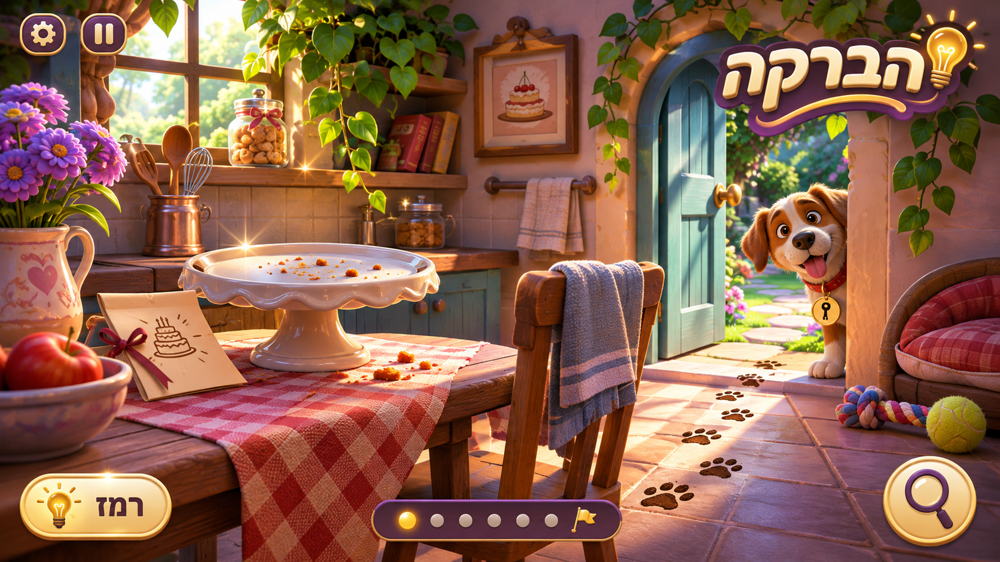

# הברקה 💡

### רואים את הרמזים. מחברים את הפרטים. מגלים את ההברקה.

**הברקה** הוא משחק חידות והרפתקה **בתלת־ממד**, שבו כל תשובה מסתתרת מול העיניים. בוחנים סצנה, מסובבים ומזיזים חפצים, מחברים רמזים ופותרים תעלומה קטנה. כל פתרון מניע את הסיפור לחידה הבאה — ומי שרוצה יכול להשוות את **זמן הפתרון** שלו לזה של חברים במסך דירוג נפרד, בלי לקבל ספוילרים.

*המחשה רעיונית למסך המשחק בתלת־ממד; אינה צילום ממשחק שכבר פותח.*

## מאפיינים מרכזיים

- 🧩 **חידות סיפוריות:** הפתרון לכל חידה מוביל לסצנה הבאה.
- 🔍 **מגע בתלת־ממד:** בדיקת חפצים, סיבוב, גרירה והפעלת מנגנונים.
- 💡 **רגע ההברקה:** משוב קצר ומספק כשהקשר בין הרמזים מתגלה.
- 📈 **התקדמות הדרגתית:** Tutorial, קל, בינוני וקשה — בלי לשנות בכל שלב את פקדי המשחק.
- ⏱️ **זמן אישי ותחרות עם חברים:** המשחק אינו מוגבל בזמן; טבלת החברים נפתחת רק במסך ייעודי ומציגה נתונים על חידות שכבר פתרת, ללא שמות או פתרונות של עולמות עתידיים.
- 📴 **משחק בסיסי ללא אינטרנט:** ההתקדמות נשמרת מקומית; השוואת חברים מקוונת תדרוש חיבור ותפותח בהמשך.

## איך משחקים?

1. פותחים סצנת חידה תלת־ממדית.
2. חוקרים את הפרטים ונוגעים בחפצים מעניינים.
3. מגלים את הקשר שמוביל לפתרון.
4. צופים בהברקה, בזמן הפתרון וברמז שמוביל לתעלומה הבאה.

## קהל יעד וטכנולוגיה

משחק עצמאי לחובבי חידות וסיפורים (קהל יעד ראשוני מוצע: גיל 12+), מיועד ל־**Unity 3D / C#**, בהתחלה ל־Android ועם אפשרות התאמה ל־iOS. לא משתמשים ב־AI או בשיפוט קולי.

## מצב הפרויקט

**בשלב תכנון.** הסצנות, החידות, העיצוב ומערכת התחרות הם אפיון מתוכנן ולא מוצר פעיל. ה־MVP המוצע כולל ארבע סצנות מקושרות, שמירה מקומית ולוח חברים מדומה; שרת ונתוני חברים אמיתיים הם שלב נפרד.

## מסמכי הפרויקט

- [אפיון פורמלי — 8 רכיבי המשחק, חוקים ותכנון ארבע הרמות](formal-elements.md)
- [סקר שוק — קהלי יעד, מתחרים, בידול ובדיקות משתמשים](market-research.md)

**חברת הצוות:** עדי פלצקי  

