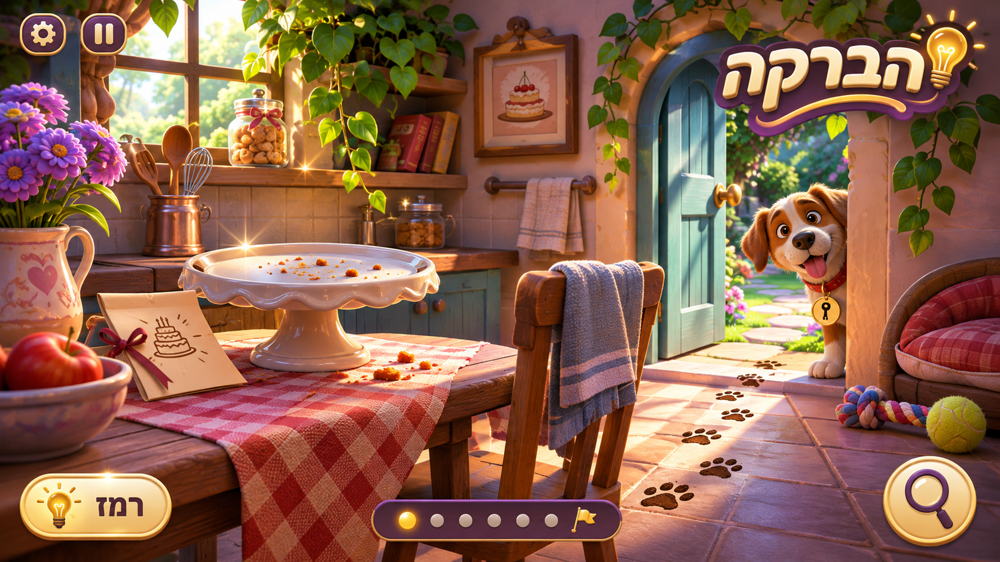
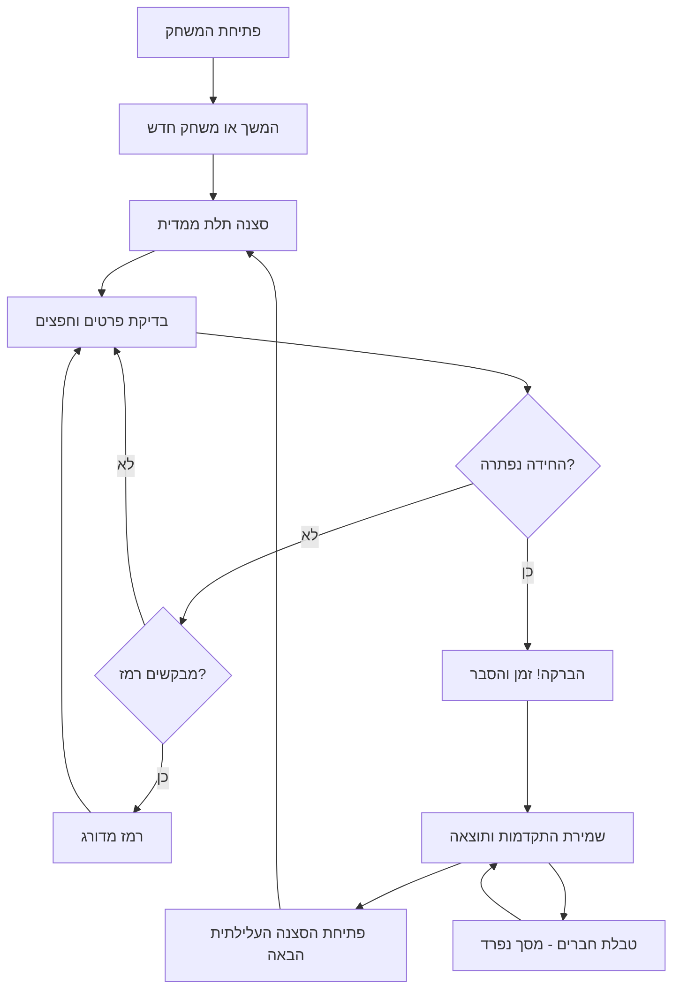

# הברקה 💡 — מסמך אפיון פורמלי

**משפט שיווקי:** **רואים את הרמזים. מחברים את הפרטים. מגלים את ההברקה.**  
**סוג:** משחק הרפתקאות וחידות תלת־ממדי לשחקן יחיד, עם תחרות זמנים אסינכרונית בין חברים.  
**פלטפורמה מתוכננת:** טלפון Android; התאמה ל־iOS בהמשך. **מנוע:** Unity 3D.  
**מגישה:** עדי פלצקי. **סטטוס:** תכנון רעיוני, טרם פותח אב־טיפוס שנבדק. **עודכן:** 

*איור 1. הדמיית קונספט בלבד — אינה צילום ממוצר פעיל. המיקום, החפצים והסגנון החזותי עדיין מוצעים לבדיקה.*

## מהות המשחק

בכל שלב מופיעה סצנה תלת־ממדית שמסתירה פתרון. השחקן בוחן חפצים, מסובב אותם, מחבר פרטים ומגלה מה באמת קרה או מה צריך לעשות. **הפתרון עצמו מוביל באופן עלילתי לסצנה הבאה.** ההתקדמות מלווה בסיפור מסתורי, תגמול קצר על גילוי ושמירת זמן פתרון אישי. במסך נפרד ניתן להשוות זמנים עם חברים **ללא הצגת שמות עולמות, רמזים או פתרונות שטרם נחשפו לשחקן**.

## שמונת הרכיבים הפורמליים

### 1. שחקנים (Players)

- שחקן אחד בכל טלפון; משחק עצמאי, בקצב אישי.
- קהל יעד ראשוני מוצע: דוברי עברית מגיל 12 ומעלה שאוהבים חידות, תעלומות, חקירה ופתרון בעיות. התאמת גיל מדויקת תיבדק עם משתמשים.
- חברים אינם משתתפים יחד באותה סצנה בזמן אמת: הם משווים זמנים בלוח נפרד, באופן אסינכרוני.
- ניתן לשחק בחידות הבסיס ללא חשבון, ובלי אינטרנט רציף; טבלת החברים מחייבת חיבור ושם תצוגה מוסכם.

### 2. יעדים (Objectives)

**מטרה מיידית:** להבין את הסיטואציה ולפתור את החידה בעזרת פרטים הנמצאים בסצנה.  
**מטרה מתמשכת:** לחשוף סיפור שבו כל פתרון מניע את החידה הבאה, ולסיים פרק.  
**מטרה משנית:** להשתפר בזמן פתרון חידות, בלי להפוך מהירות לתנאי מעבר.

**הצלחה אינה בחירה אקראית בתשובה:** נדרשת אינטראקציה עם פריטים או הסקה הנתמכת לפחות בשני רמזים, בהתאם לסוג החידה. הסברים נחשפים לאחר פתרון, כדי לעודד הבנה ולא ניחוש מקרי.

### 3. תהליכים (Procedures)

**פתיחת משחק:** מסך ראשי → "משחק חדש" / "המשך" → סצנת Tutorial קצרה → הפרק הראשון.  
**לולאת המשחק:** מתבוננים → לוחצים / מסובבים / מזיזים חפץ → מקבלים תגובה מהעולם → מחברים פרטים → פותרים → אנימציית "הברקה!" → זמן ותוצאה → מעבר לסצנה הבאה.

**פקדים בטלפון:**
1. הקשה על חפץ (`Tap`) כדי להתמקד או לבצע פעולה.
2. גרירה (`Drag`) כדי להזיז חפץ במסגרת גבולותיו.
3. סיבוב חפץ בתצוגת בדיקה (`Rotate`) באמצעות גרירה על ציר מוגדר; כפתור "חזור" מחזיר למצלמה הקבועה.
4. "רמז", "השהה" ו"טבלת חברים" מוצגים כמסכים/כפתורים נפרדים.

**דוגמה קצרה:** במטבח נעלמה עוגה; סימני כפות מובילים לדלת, ועל קולר הכלב יש פירורי קצפת. גילוי הקשר מפעיל את סצנת המלונה. עלילת הדוגמה ניתנת לשינוי לאחר בדיקת משחק.

#### מדידת זמן

הטיימר של חידה מתחיל ברגע שהשחקן לוחץ **"התחל חידה"** והסצנה נחשפת לראשונה (לא בפעולה הראשונה על חפץ — כדי שלא יהיה אפשר לחשוב זמן רב לפני תחילת המדידה). הוא נעצר בפתרון, **ואינו סופר** מסכי השהיה, רמזים או זמן שבו האפליקציה ברקע:

\[
T_{\mathrm{solve}}=\sum_{i=1}^{n}(t_{i,\mathrm{end}}-t_{i,\mathrm{start}})
\]

הסכום כולל רק חלונות משחק פעיל, כדי שלא להעניש שחקן שעצר את האפליקציה. בעת הפסקה/רמז הסצנה מוסתרת כדי לצמצם חשיבה כשהשעון עצור; אין דרך למנוע לחלוטין מחשבה מחוץ לאפליקציה, לכן התחרות ידידותית בלבד. נשמרים זמן עד פתרון ראשון, מספר רמזים ושיא אישי (אם משחקים שוב). טבלת החברים משווה **פתרון ראשון** לאותה חידה בלבד; חזרה לאחר שכבר יודעים את התשובה לא תגרום לדירוג לא הוגן. תוצאות עם רמזים ובלי רמזים יוצגו בנפרד או יסומנו באופן גלוי — החלטת UX סופית תיבדק בפיילוט.

### 4. חוקים (Rules)

- אפשר להתקדם רק אחרי פתרון החידה הנוכחית, או באמצעות מעבר מפורש ברשות המפתחת לצורכי בדיקה; אין "דלג שלב" רגיל.
- כל פתרון חייב להתבסס על רמזים נגישים ולא על ניחוש שרירותי.
- אין מגבלת זמן לפתרון; הזמן משמש מדד השוואה בלבד.
- אפשר להשהות ולחדש; מצב החפצים, הרמזים וההתקדמות נשמרים מקומית.
- מערכת הרמזים כוללת עד שלוש דרגות מדורגות, שאינן חושפות מיד את התשובה; שימוש ברמז אינו חוסם התקדמות.
- ניתן לטעות ללא "חיים" או ענישה; ניסיון שגוי נותן משוב קצר ולא מאפס את החידה.
- חידה שנפתרה פותחת בדיוק את הצומת העלילתי הבא בגרסת ה־MVP, כדי להימנע מפיצול מסלולים יקר לפיתוח.
- בתוצאות חברתיות אין חשיפה של שמות עולמות, תיאורי סצנות, חפצים, תשובות או שלבים נעולים. אחרי פתרון, ניתן לראות זמנים של **אותו מזהה חידה בלבד**, תחת תווית ניטרלית כגון "אתגר 03".
- שיתוף חברים נעשה בהסכמה באמצעות כינוי וקוד/הזמנה. אין העלאת אנשי קשר ללא רשות.
- בתחרות נרשם רק הזמן של **הפתרון הראשון**. שיאים משופרים במשחק חוזר נשמרים לשחקן עצמו, בנפרד.
- המשחק עצמו יפעל ללא שרת; טבלת החברים המקוונת תסתנכרן כשיש אינטרנט. עד אז יוצגו נתונים מקומיים בלבד.

**מצבי קצה:** יציאה בזמן גרירה מחזירה את הפריט למצב תקין לאחר שחזור; איבוד אינטרנט אינו מוחק זמן/פתרון; תשובה שנשלחה פעמיים לא נרשמת פעמיים; אין לחשוף כותרת חידה נעולה באמצעות התראה או קישור; אי־אפשר להזין זמן ידנית לטבלה. אמינות תוצאות מקוונות עדיין דורשת הגנות ובדיקות.

### 5. משאבים (Resources)

- **זמן פעיל:** מדד ביצוע ולא משאב שמתכלה.
- **רמזים:** עד שלוש בקשות בכל חידה, ללא צורך במטבעות.
- **מידע:** פריטים שנבדקו, תצפיות ורמזים שהתגלו.
- **מצב סצנה:** זווית מצלמה, מיקום חפצים, מתגים שנפתחו, אובייקטים שנמצאו.
- **התקדמות:** מזהה חידה פתוחה, חידות שנפתרו וסטטוס הפרק.
- **תוצאה חברתית:** זמן פתרון ראשון + מספר רמזים + כינוי, ללא מידע על התוכן העלילתי.

### 6. עימותים (Conflicts)

- **שחקן מול החידה:** ההסבר אינו ברור במבט ראשון; נדרש לחבר ראיות או לזהות קשר.
- **שחקן מול עצמו:** האם אוכל למצוא פתרון עם פחות רמזים, ולהשתפר בסוגי חשיבה שונים?
- **תחרות אסינכרונית:** אחרי פתרון ניתן לראות אם פתרתי מהר יותר מחברים. תחרות לא עוצרת את הסיפור ואינה תנאי לניצחון.
- **מתח עלילתי:** כל פתרון עונה על שאלה אחת אך מעלה שאלה חדשה.

### 7. גבולות (Boundaries)

- העולם תלת־ממדי אך **אינו עולם פתוח**. בכל חידה יש סביבה קטנה עם מצלמות ממוקדות וחפצים אינטראקטיביים מוגדרים.
- אין תנועה חופשית, קרבות, צ'אט במשחק, מערכת אווטרים מורכבת, קריינות AI או בניית עולמות פתוחים בגרסה הראשונה.
- ניתן לחקור רק חפצים שסומנו אינטראקטיביים; האחרים הם תפאורה.
- לכל סצנה נקודת התחלה ברורה, סט פעולות חוקיות, תנאי פתרון חד־משמעי ומעבר מתוסרט לסצנה הבאה.
- בטלפון המשחק משתמש במגע; הגדלה ותנועה של המצלמה מוגבלות כדי למנוע בלבול והוצאות פיתוח מיותרות.

### 8. תוצאות (Outcomes)

**לאחר חידה:** המשוב "הברקה!", הסבר קצר למה הפתרון הגיוני, זמן פתרון, כמה רמזים נוצלו ומעבר לסצנה הבאה.  
**לאחר פרק:** סיכום עלילתי ופתיחת הפרק הבא. אין הפסד בגלל זמן איטי.  
**בטבלת חברים:** דירוג זמן לחידות שנפתרו על־ידי השחקן בלבד, בלי חשיפת מידע על שלבים עתידיים.

## תוכנית ארבע דרגות הקושי — טיוטת פיתוח

הסיפור והדמויות הם **הצעה יצירתית** שמספקת רצף הדגמה למתכנת; טרם נבדקו עם שחקנים.

| דרגה | סצנה | פעולות נדרשות | פתרון / מעבר | סיבת הקושי |
|---|---|---|---|---|
| 00 · Tutorial | מטבח החגיגה | הקשה על מגש ריק, מעקב אחרי סימני כפות, בדיקת קולר | הכלב → המלונה | שני רמזים גלויים והדרכה בהקשר |
| 01 · קל | מלונת הכלב | הזזת קערה, סיבוב צעצוע, בדיקת רעש מתוכו | מפתח קטן → סדנה | חיפוש קשר בין שני חפצים ומניפולציה פשוטה |
| 02 · בינוני | סדנה נעולה | פתיחה במפתח, בדיקת גלגל שיניים, הצלבת פתק עם מחוגים | שעון → מגדל השעונים | שלושה רמזים ופרט מטעה אחד |
| 03 · קשה | מגדל השעונים | סיבוב מנגנון, שינוי כיוון אור, התאמת צל למחוגים | מעבר נסתר → פתיחת פרק חדש | הסקה רב־שלבית ושינוי נקודת מבט |

### מפרט תרחיש ראשוני למימוש (MVP)

**סדר:** `P00 → P01 → P02 → P03 → ChapterComplete`. בכל שלב מזהה חידה קבוע, ללא שמות עלילתיים בטבלת החברים.

| מזהה | אובייקטים אינטראקטיביים | פעולות ותגובות מדויקות | תנאי פתרון | מעבר |
|---|---|---|---|---|
| `P00` | `CakeStand`, `Pawprints`, `DogCollar` | נגיעה במגש מציגה "העוגה נעלמה"; נגיעה בסימני כפות מדגישה את כיוונם; נגיעה בקולר מגדילה אותו ומראה שאריות קצפת | `cakeInspected && printsInspected && collarInspected`, ואז לחיצה על "להמשיך בעקבות הכלב" | `P01` |
| `P01` | `DogBowl`, `Toy`, `ToyLatch` | גרירת הקערה מגלה סימן מפתח; סיבוב הצעצוע ב־180° חושף תפר; לחיצה על התפר פותחת תא קטן | `bowlMoved && toyRotated && latchOpened` | `P02` עם מפתח במלאי |
| `P02` | `WorkshopDoor`, `Gear`, `Note`, `ClockDial` | משתמשים במפתח לפתיחה; מקישים על גלגל תקוע; בפתק ציור של שני מחוגים; מסובבים את מחוגי החוגה לערכים הנראים בפתק | `doorOpen && noteRead && handsAligned` | `P03` |
| `P03` | `Lamp`, `ClockFace`, `ShadowPanel` | מסובבים את גוף השעון; מזיזים את המנורה למסילה המסומנת; על הלוח מופיע צל של חץ למעבר | `clockTurned && lampAligned && shadowObserved` ואז נגיעה בלוח | `ChapterComplete` |

**תנאי קבלה:** הקשה על חפץ שאינו אינטראקטיבי לא תשנה מצב; פעולה לא חוקית תחזיר משוב קצר; כל חידה ניתנת לפתרון בלי רמזים; לאחר השהיה וחידוש החפצים נשארים במקומם; מעבר לא חושף את שם החידה הבאה לפני פתיחתה.

### תרשים זרימת משחק

## שלושה משחקים קיימים — השוואה וסקירה

**ביטויי חיפוש:** `The Room 3D puzzle official`, `The House of Da Vinci 3D puzzles`, `Gorogoa visual puzzle storytelling`, `mobile tactile puzzle mystery`.

### The Room — חקירה ומגע בתלת־ממד

**מקור:** [Fireproof Games — The Room](https://www.fireproofgames.com/games/the-room)  
  
*מקור צילום: Softonic; הזכויות ביצירה שייכות לבעליה.*

משחק חידות עם מנגנונים פיזיים, תיבות מסתוריות ומגע בחפצים. **דמיון:** חפצי תלת־ממד ובחינת פרטים. **הבדל מוצע:** אצלנו פתרון כל חידה הוא גם הגשר העלילתי לסביבה הבאה, עם השוואת זמנים אישית בין חברים. עצם השימוש בתלת־ממד אינו ייחודי.

### The House of Da Vinci — שרשרת מנגנונים

**מקור:** [Blue Brain Games — The House of Da Vinci 3](https://www.bluebraingames.com/the-house-of-da-vinci-3)  
  
*מקור צילום: PlayStation, מתוך עמוד המוצר של המשחק.*

הרפתקה עם מנגנונים תלת־ממדיים וחידות המקושרות לעלילה. **דמיון:** חקירת סביבות, אובייקטים, תעלומה מתפתחת. **הבדל מוצע:** חידות קצרות יותר, שפה נגישה ותחרות אסינכרונית שאינה חושפת התקדמות עלילתית. זו **השערת בידול** שדורשת בדיקת משחק.

### Gorogoa — החיבור בין פרטים

**מקור:** [Annapurna Interactive — Gorogoa](https://www.annapurna.com/interactive/gorogoa)  
  
*מקור צילום: Creative Bloq, צילום מתוך המשחק.*

משחק שבו מחברים פרטים בין ציורים כדי לחשוף משמעות חדשה. **דמיון:** רגע "אהה" והסקת קשרים. **הבדל:** ההצגה אצלנו תלת־ממדית, עם בדיקת חפצים ומסלול חידות המתגלגל אחת מתוך השנייה.

**מקוריות מוצעת:** לא המצאנו חידות תלת־ממד, סיפורים מתמשכים או טבלאות שיאים. אנו בודקים האם **השילוב** של פתרון שפותח את נושא הסצנה הבאה + חידות תלת־ממד קצרות ונגישות + השוואת זמן ללא ספוילרים מייצר חוויה מובחנת.

## גבולות ה־MVP וסוגיות פתוחות

**למימוש ראשון:** ארבע סצנות ברצף, מנגנון מגע/סיבוב/גרירה, רמזים מדורגים, אנימציית הצלחה, מדידת זמן, שמירה מקומית, מסך טבלת חברים כ־UI מדומה.  
**שלב שני:** חיבור מקוון אמיתי לחברים, הרשאות, סנכרון ואימות תוצאות בסיסי.  
**לא ב־MVP:** עולם פתוח, עשרות חידות, מערכת AI, צ'אט, תנועה חופשית, רכישות, קריינות או תוכן שנוצר אוטומטית.

**עדיין נדרש אישור או בדיקה:** עלילת העיירה והדמויות; גיל יעד; האם להציג דירוגי רמזים בנפרד; אופי הגרפיקה; מידת הקושי וסיבתיות החידות; האם להתחיל ב־Android בלבד או בשתי חנויות; מודל המימון. כל הנתונים שלא נבדקו הם **הצעות תכנון**, לא ממצאי משתמשים.
