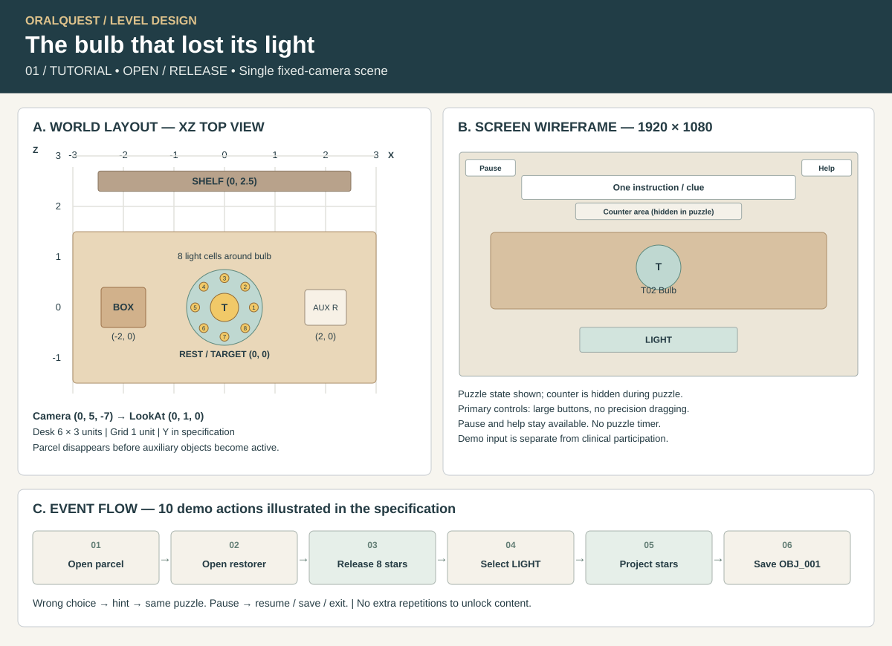
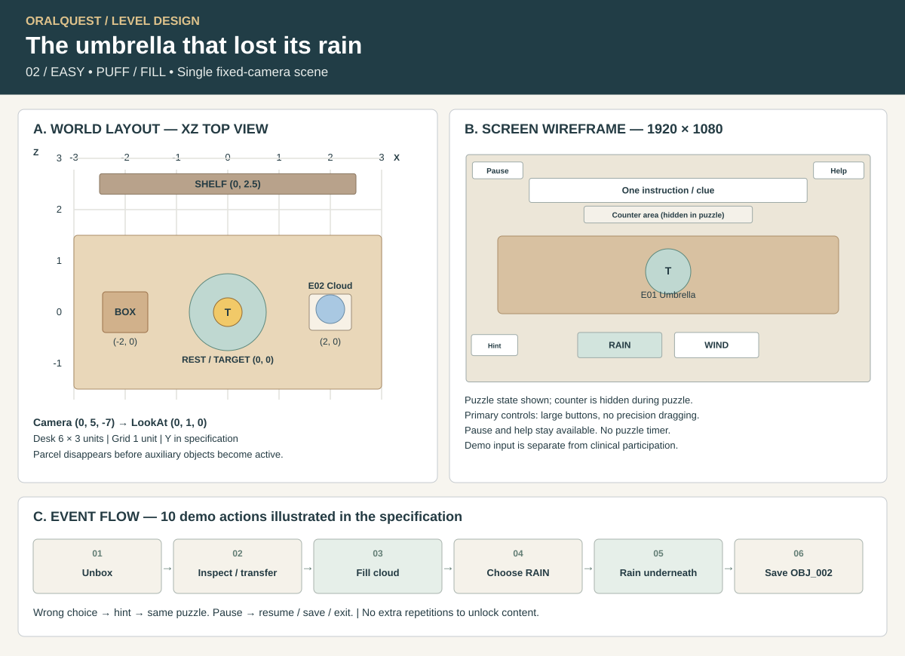
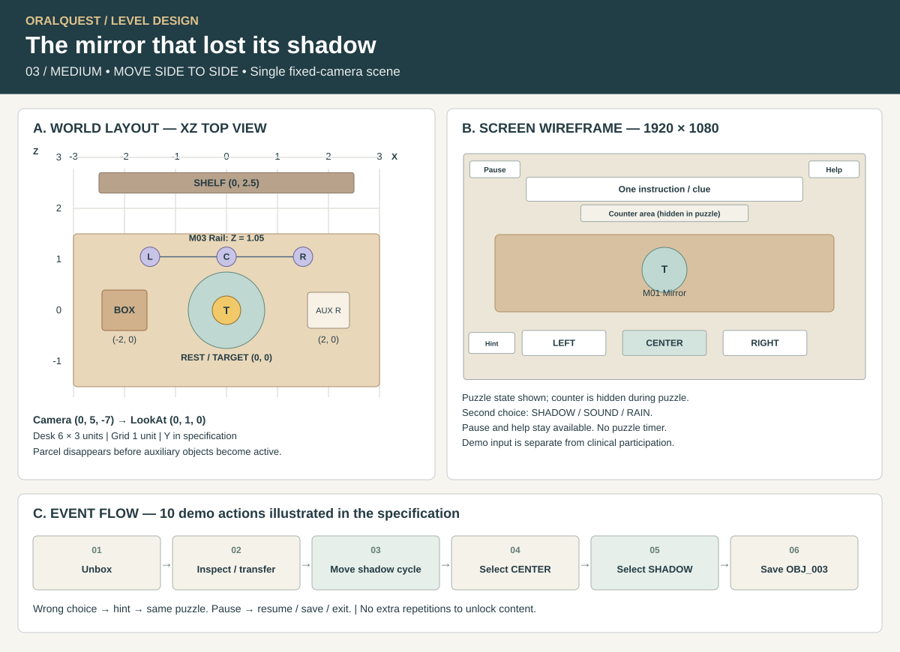
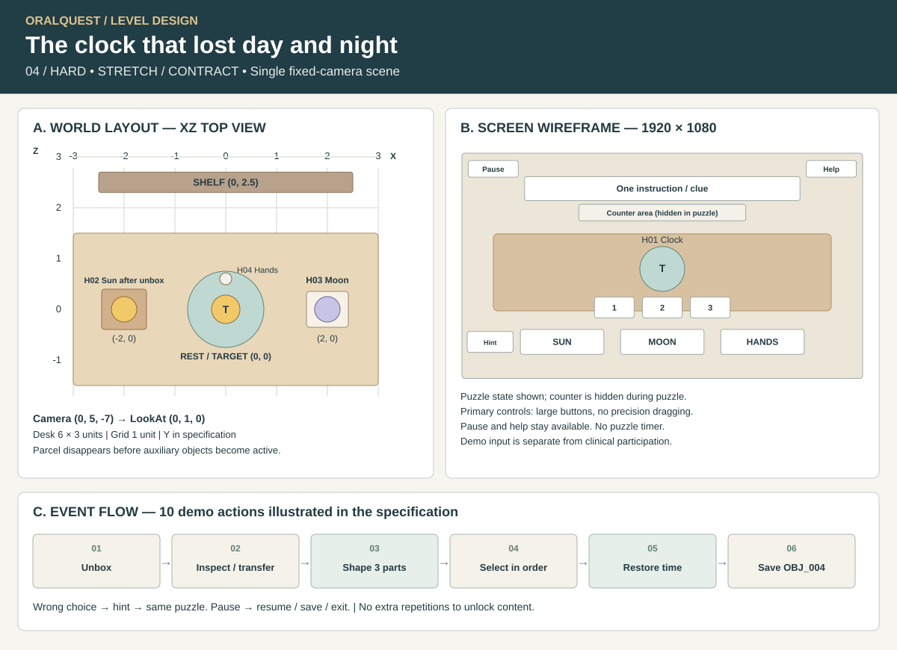

<div dir="rtl" lang="he">

# OralQuest — משרד האבידות של היקום
## מסמך תכנון רמות ומפרט מימוש (Level Design)

**חברת הצוות:** עדי פלצקי | **גרסה:** 1.0 | 24.11.2026  
**בסיס:** FormalElements v3.0, Market_Research v3.0, Clinical_Needs_Analysis, רשימת התרגילים והחלטות התכנון שאושרו בשיחה.  
**סטטוס:** מפרט לאב־טיפוס Unity 3D בקלט מדומה; טרם מומש, טרם נבדק עם משתמשים, אינו פרוטוקול רפואי.

## 1. תמצית והחלטות

השחקן מקבל אבידה שאיבדה תכונה, מגלה מה חסר, מפעיל את המשחזר באמצעות פעולות בעלות משמעות עקבית, פותר חידה ומקבל אבידה לאוסף. ארבע הרמות משתמשות באותה סצנה, מצלמה קבועה ופקדים פשוטים.

| מספר בהגשה | מזהה בקוד | אבידה | משמעות הפעולה | קושי משחקי |
|---|---|---|---|---|
| 1 — Tutorial | L00 | נורת הכוכבים | פתיחה ושחרור | פעולה מודרכת |
| 2 — Easy | L01 | המטרייה שאיבדה את הגשם | ניפוח ומילוי | בחירה בין 2 אפשרויות |
| 3 — Medium | L02 | המראה שאיבדה את הצל | הזזה מצד לצד | קישור שני חפצים ובחירה מ־3 |
| 4 — Hard | L03 | השעון שאיבד את היום והלילה | שינוי צורה | סידור של 3 חלקים |

ארבע רמות בסך הכול, כולל ההדרכה. המספור בקוד מתחיל ב־0. רמת קושי אינה דרגת חומרה רפואית ואינה קובעת מינון. תרגילי הדוגמה נלקחו מהרשימה שמסרה המפתחת; 10 חזרות הן **נתוני בדיקה בלבד**, לא הוראה למטופל. התרגול בפועל דורש אישור, התאמה ותיקוף. התדירות המשוערת של כשלושה מפגשים לפני הארוחות דורשת אימות אישי; אין פעילות בזמן אכילה.

### קשר לסקר השוק

| מקור או ממצא | החלטת עיצוב שניתנת לבדיקה |
|---|---|
| פרסונות מבוגרים ללא ניסיון, קשיי הבנה ועייפות | לחיצה במקום גרירה, מצלמה קבועה, הוראה אחת, רמזים, עצירה והמשך |
| Duolingo (השראה, לא ראיה קלינית) | מפגשים מתוכננים, רצף אישי אופציונלי, אין בונוס על חזרות נוספות |
| Assemble with Care | שינוי חזותי בכל פעולה והפתעה בסיום |
| A Little to the Left | התאמה וסידור באמצעות לחצנים ברורים |
| Monument Valley / Forgotton Anne | חוק פנטזיה עקבי: תכונות הולכות לאיבוד; אין צורך במנוע גאומטריה מורכב |
| המחקר הקליני, סעיפים 4–7 | הפרדת זיהוי, פעולת משחק ותוצאה קלינית; קלט חלופי; מכסה אישית; בדיקה טכנית תחילה של תנועה אחת |

הקשרים הם החלטות עיצוב, לא ראיות שהמשחק ישפר שיקום. לא נערך מחקר שוק חדש במסגרת מסמך זה.

## 2. תשתית משותפת לכל הרמות

### 2.1 סצנה ומרחב

סצנה יחידה `LostAndFoundOffice.unity`. יחידה אחת = יחידת Unity. X ימינה, Y למעלה, Z לעומק. כל המיקומים הם מרכזי אובייקטים (מלבד נקודות עיגון מפורשות). ערכי graybox מוצעים לבדיקה, לא מידות אמנות סופיות.

| מזהה | אובייקט | Position X,Y,Z | גודל X,Y,Z / הגדרה |
|---|---|---|---|
| DESK | שולחן | (0,0.5,0) | (6,1,3) |
| PARCEL | חבילה | (-2,1.25,0) | (0.9,0.5,0.8) |
| REST | בסיס משחזר | (0,1.1,0) | (1.5,0.2,1.5) |
| TARGET | עיגון החפץ הראשי | (0,1.2,0) | נקודת בסיס של המודל |
| AUX_L | עיגון עזר שמאל | (-2,1.2,0) | אחרי העלמת החבילה |
| AUX_R | עיגון עזר ימין | (2,1.2,0) | נקודת בסיס |
| SHELF | מדף אוסף | (0,1.9,2.5) | (5,1.2,0.4) |
| CAM | מצלמה | (0,5,-7) | Orthographic Size 3.7; LookAt (0,1,0) |

חבילת המשלוח נשארת באותו מקום בכל רמה. כאשר היא נפתחת, החפץ מופיע בתוכה; בלחיצה על העברה למשחזר הוא עובר ל־TARGET והחבילה מוסתרת. בהדרכה המעבר מתרחש אוטומטית לאחר פעולת פתיחת המשחזר. אין חפיפות בין רכיבים פעילים. אובייקטים דקורטיביים אינם לחיצים.

### 2.2 ממשק משותף

Canvas ב־1920×1080, Scale With Screen Size, Match 0.5. קואורדינטות בטבלה הן מרכזים בפיקסלים מהפינה השמאלית העליונה; רוחב וגובה בפיקסלים. ב־Unity יש להמיר ל־RectTransform anchors בהתאם. טקסט עברי מימין לשמאל עם גופן תומך; לא להסתמך על צבע או קול בלבד.

| מזהה | רכיב | מרכז X,Y | רוחב×גובה | מתי זמין |
|---|---|---|---|---|
| U01 | עצירה | 150,75 | 240×80 | כל מסך עבודה, גם אנימציה |
| U02 | עזרה | 1770,75 | 240×80 | כל מצב; הקראה/הדגמה ללא חזרה פיזית |
| U03 | הוראה אחת | 960,170 | 1320×115 | תמיד |
| U04 | התקדמות בסט + מצב דמו/מאושר | 960,285 | 800×80 | פעילות ומנוחה בלבד |
| U05 | פעולה ראשית | 960,905 | 760×120 | מצבי פתיחה, העברה, אישור, סיכום |
| U06a | בחירה 1 מתוך 2 | 730,905 | 400×120 | בחירה זוגית |
| U06b | בחירה 2 מתוך 2 | 1190,905 | 400×120 | בחירה זוגית |
| U07a,b,c | 3 אפשרויות | 480/960/1440,905 | 400×120 כל אחת | בחירה משולשת/סדר |
| U08 | רמז | 135,905 | 220×100 | חידה בלבד |
| U09 | חזרה לבית | 1740,905 | 240×100 | סיכום, עצירה |

הכפתורים החלופיים באותו אזור אינם מוצגים בו־זמנית. אין צורך לגרור או ללחוץ במדויק על מודל קטן; לחיצה על אובייקט פעיל היא קיצור דרך לכפתור הראשי. Tab/Enter לבחירה, Esc לעצירה. במצב דמו כפתור ״הדמיית פעולה״ או Space מייצר אירוע בדיקה. לא תוצג דרישה לבצע תנועת פה במצב דמו. תצוגת ההדגמה יכולה להראות את הקשר לתנועה בלי להורות לחקות אותה.

### 2.3 מסכים ומצבים משותפים

| מצב | מסך / מה מוצג | אירוע ומעבר |
|---|---|---|
| HOME | המשימות, האוסף, התקדמות היום ושיא (אופציונלי) | בחירת רמה זמינה / מפגש → READY |
| READY | שם האבידה או חבילה מסתורית; מצב דמו או תוכנית תקפה | התחלה → UNBOX; אם חסרה הרשאה, רק דמו/משחק רגיל |
| UNBOX | חבילה והוראת פתיחה | לפי הרמה: לחיצה פותחת או מפעילה הקשר פעולה ראשון → ACTIVITY/INSPECT |
| INSPECT | תגובת החפץ ורמז | העברה למשחזר → ACTIVITY; בהדרכה העברה אוטומטית |
| ACTIVITY | הדגמה, מונה, חפץ מגיב | `AcceptedAction` תקף אחד → תגובה ומונה; מכסה הושלמה → PUZZLE |
| REST | מנוחה לפי הגדרה, ללא קלט פעילות | רק כשהמגבלה מאפשרת → ACTIVITY; ניתן לעצור |
| PUZZLE | אפשרויות או חלקים לסידור | פתרון נכון/מודרך → RESTORE; תשובה שגויה נשארת כאן |
| RESTORE | אנימציית שחזור (1.5–2 שניות בדמו; ניתן לדלג) | `AnimationFinished` או דילוג → COMPLETE |
| COMPLETE | אבידה, אוסף, סטטוס פעילות נפרד | שמירה פעם אחת, חזרה לבית/יומן |
| PAUSED | המשך, שמירה ויציאה, המשך ללא פעילות | השהיית קלט; חזרה למצב שמור רק אם עדיין מותר |
| INPUT_UNAVAILABLE | הודעה ״לא הצלחנו לזהות את הפעולה״ | עזרה, עצירה, או המשך רגיל; ללא הוספת חזרה |

**משמעות מצב:** ACTIVITY כולל תתי־שלבים ייחודיים לכל רמה. כשהאנימציה מגיבה, פקודות חדשות נחסמות עד מוכנות המערכת; עצירה תמיד זמינה. אין קנס על חוסר תגובה. לחיצה על עזרה משחזרת הוראה ולא מאפסת מונה.

### 2.4 אירועי פעילות ומכסה

`ActionType`: `OpenClose`, `PuffRelease`, `LateralCycle`, `StretchPucker`.

- בדמו כל לחיצה/Enter/Space אחת במצב ACTIVITY מדמה מחזור שלם; שחרור הכפתור נדרש לפני הבא. קליק כפול, מקש מוחזק, מזהה אירוע שכבר נצרך וקלט בזמן אנימציה אינם נספרים. דמו אינו נרשם כהשלמה טיפולית.
- במצב עתידי מאושר, מתאם קלט שולח אירוע רק בסיום יחידה שהוגדרה על ידי הקלינאית, עם תנאי זיהוי שנבדקו. אין לקבוע ספים, משכי החזקה, מהירות או כמות טיפולית מתוך מסמך זה. זיהוי אינו אימות של כוח, איכות ביצוע, בליעה או שיפור קליני.
- פתיחה/סגירה: אירוע לאחר רצף פתיחה וחזרה למצב הנדרש; ניפוח: לאחר מחזור ניפוח וחזרה; לצדדים: מחזור של שני צדדים לפי ההגדרה האישית, ולא ספירה לכל כיוון בנפרד; אי→או: לאחר שני מצבים חזותיים לפי הגדרה. אם הפעילות המאושרת כוללת אמירה קולית, זיהוי חזותי לבדו אינו מאמת אותה. סדר/טווח/מנוחה יגיעו מהתוכנית המקצועית בלבד.
- `N` הוא מספר אירועי פעילות שהוקצו לקטע הנוכחי, עד גבול התוכנית. `k` מונה מצטבר בקטע. `p=k/N`. בדוגמת דמו N=10. במצב רגיל ללא פעילות ניתן להציג אותו שינוי באמצעות כפתור, או לדלג ישירות לסיום החלק החזותי; אין ספירה טיפולית.
- בין סטים ומפגשים: שמירה, מנוחה אם הוגדרה, איסור איפוס מכסה. אם הוקצו מספר סטים לאותה אבידה, התקדמות חזותית משקפת את סך האירועים בבלוק המוקצה; הממשק מציג גם סט נוכחי. לא עוברים לסט הבא עד שהמנוחה הסתיימה לפי התוכנית. אם אין פעילות מאושרת או N=0, אין מסך פעילות; עוברים לחידה בקלט רגיל.
- לכל חפץ יש סוג תנועה מוצע. אם הוא אינו תואם לתוכנית או אינו נתמך, משחקים את החידה בקלט רגיל, או בוחרים חפץ מתאים מתוך תוכן מאושר. לא משנים תרגיל לפי דרגת קושי ולא ממפים תנועה באופן שסותר את משמעותה הקבועה. מפגש מרובה תרגילים יכול לכלול מספר בלוקים; ארבע החידות אינן תחליף לספריית כל התרגילים. אם אין תוכן מתאים, הבלוק אינו נתמך באב־טיפוס ואין לסמן שהושלם.

**כלל התאמת אנימציות:** אין לחייב 10 חזרות כדי להשלים אבידה. בשלבים עם אבני דרך בדמו, אבן דרך מספר j מתוך 10 נחשפת ברגע ש־`floor(10*k/N) >= j`. אם N קטן, כמה אבני דרך מוצגות ברצף קצר באותו אירוע; אם N גדול, בכל אירוע יש לפחות הבהוב/תזוזה קטנה ומד התקדמות, גם ללא אבן דרך. ברגע N מושגת מוכנות לחידה בלבד, לא השלמה רפואית אוטומטית. ברמה 0 שתי אבני הדרך הראשונות הן פתיחת חבילה ומשחזר; אם N=1 הן נפתחות באותו רצף, עם הכוכבים. ברמה 2 תנועת המחזור מקבלת אנימציית הלוך־חזור בכל אירוע.

### 2.5 פתיחת רמות והתקדמות

הדרכה זמינה מההתחלה; פתרון עצמאי או מודרך פותח את הבאה. ניתן לחזור לכל רמה פתוחה בקלט רגיל; פתיחת תוכן לא תלויה בהשלמת תרגול. אין נעילת סיפור בגלל הפסקה. תרגול מותנה במפגש מתוכנן ולא בכפתור ״שחק שוב״. רמז ראשון, ואחרי שתי בחירות שגויות מוצע פתרון מודרך — בלי תרגול חוזר. אפשר לבחור פתרון מודרך גם לפני הטעות הראשונה.

## 3. רמה 1 — Tutorial: הנורה שאיבדה את האור (`L00`)

**מטרה:** לימוד שפת השליטה: פתיחה ושחרור. אין טעות אפשרית בחידה. ההיכרות הראשונה היא דמו בלבד, ללא תרגול פיזי וללא השפעה על הרצף. בעתיד אפשר להשתמש באותה אבידה במפגש מאושר, ללא כפילות באוסף.



### אובייקטים

| מזהה | פריט | מיקום / מצב התחלתי | פעולה |
|---|---|---|---|
| T01 | חבילה | PARCEL, סגורה | פתיחת מכסה |
| T02 | נורה | מוסתרת בחבילה; אחר כך TARGET | כבויה → זוהרת |
| T03 | דלת המשחזר | REST, סגורה | פתיחה וסגירה בהנפשה |
| T04 | 8 תאי אור | ביחס ל־TARGET: רדיוס 0.58 במישור XZ, Y=1.65 | כל תא נפתח פעם אחת ומשחרר כוכב |
| T05 | אפקט כוכבים | מעל TARGET, Y=2.4 | מופעל בסיום |

נורה בגובה 0.5; 8 תאי אור בגודל 0.12. מיקום התא i (i=0..7): X=0.58cos(2πi/8), Y=1.65, Z=0.58sin(2πi/8). הכוכבים נעים אל הנורה בנתיב אנימציה, בלי פיזיקה.

### מסכים, כפתורים ופעולות

| מסך / מצב | מה רואים | פעולה / לחיצה | מה קורה בפועל |
|---|---|---|---|
| READY | חבילה סגורה והודעה ״הגיעה האבידה הראשונה״ | מתחילים | המצלמה נשארת קבועה; מופיע הסבר ״פתיחה משחררת דברים״ |
| ACTIVITY / Box | חבילה, הדגמה חזותית | כפתור ״הדמיית פתיחה״ | מחזור ראשון פותח מכסה; הנורה נחשפת; הוראה מתחלפת |
| ACTIVITY / Restorer | נורה כבויה בתוך החבילה | הדמיית פתיחה | דלת המשחזר נפתחת, הנורה עוברת ל־TARGET, החבילה מוסתרת; הדלת נסגרת |
| ACTIVITY / Stars | נורה, תאי אור ומונה | הדמיית פתיחה בכל מחזור | תא נפתח, כוכב נכנס לנורה, הזוהר עולה; אחרי התא האחרון מופיעה תכונת אור |
| PUZZLE | כרטיס יחיד ״אור״ | לחיצה על אור | התכונה נכנסת לנורה; אין אפשרות שגויה |
| RESTORE | נורה במרכז | אוטומטי או דילוג | כוכבים מוקרנים על החדר; אין דרישה לפעולה נוספת |
| COMPLETE | ״נורת הכוכבים נוספה לאוסף״ | לבית / יומן | שמירת `OBJ_001`; פתיחת L01; דמו אינו משנה רצף |

### כל חזרה בדוגמת 10 אירועים

| k | תוצאה חדשה |
|---|---|
| 1 | מכסה החבילה נפתח; נורה כבויה נחשפת |
| 2 | המשחזר נפתח; הנורה עוברת לתוכו |
| 3 | תא 1 נפתח; כוכב נכנס; נצנוץ ראשון |
| 4 | תא 2 נפתח; כוכב שני |
| 5 | תא 3 נפתח; מופיע זוהר חלש |
| 6 | תא 4 נפתח; הילה סביב הנורה |
| 7 | תא 5 נפתח; הילה מתרחבת |
| 8 | תא 6 נפתח; דוגמת כוכב על הזכוכית |
| 9 | תא 7 נפתח; הנורה זוהרת יותר |
| 10 | תא 8 נפתח; כרטיס האור נחשף; קלט פעילות נסגר |

לאחר k=10, לחיצה על אור מפעילה את ההפתעה הסופית; אין חזרה 11. לצורך הכרות קצרה אפשר לבחור `N=1` בדמו. העיקרון זהה וניתן לראות את כל הרצף בלחיצה אחת.

**בדיקות קבלה:** החבילה לא נפתחת פעמיים; 8 תאים לכל היותר גם ב־N שונה; בסיום אין קלט פעילות; לחיצה על אור מוסיפה OBJ_001 פעם אחת; אין שינוי ביומן הפעילות או ברצף מדמו.

## 4. רמה 2 — Easy: המטרייה שאיבדה את הגשם (`L01`)

**מטרה:** ללמוד ניפוח ומילוי, ולבחור תכונה אחת לפי רמז. החפץ נפתח בתחילת הרמה בלחיצה רגילה (לא בתרגיל פתיחת פה; הפעולה המוטורית המוצעת כאן היא ניפוח בלבד).



### אובייקטים

| מזהה | פריט | מיקום / מצב התחלתי | פעולה |
|---|---|---|---|
| E01 | מטרייה | בחבילה → TARGET; גובה 0.8 | פתיחה בחקירה; אינה משחררת גשם |
| E02 | ענן | AUX_R + (0,0.7,0), כלומר (2,1.9,0) | גדל ב־Scale ובאפקט חלקיקים |
| E03 | טיפות | עיגון מתחת לענן | מופיעות בהדרגה; מוסתרות בתחילה |
| E04 | תכונות גשם ורוח | U06a/U06b | כפתורים עם סמל וכיתוב |

הענן משמש דגימת תכונה; אינו נכנס למטרייה לפני בחירת פתרון. כל האפקטים מוצגים במיקום קבוע, לא בתנועת מצלמה.

### מסכים, כפתורים ופעולות

| מסך | מה רואים | פעולה | תגובה |
|---|---|---|---|
| READY/UNBOX | חבילה חדשה | פתיחת חבילה | מטרייה מתגלה; החבילה פתוחה |
| INSPECT | מטרייה | לחיצה ״בדקו את המטרייה״ | היא נפתחת; נשמע/מוצג ״אפילו טיפה אחת לא יורדת״; כפתור העברה מופיע |
| ACTIVITY | מטרייה ב־TARGET, ענן קטן מימין | הדמיית ניפוח / אירוע תקף | הענן מתמלא; מונה מתעדכן; אין צורך לנפח חזק/מהר יותר |
| PUZZLE | ״איזה מזג אוויר היא איבדה?״ | גשם / רוח | גשם = פתרון; רוח = משב קצר ורמז ״לא ירדה אפילו טיפה״. הכפתורים נשארים; אין חזרה לתרגול |
| RESTORE | הענן והמטרייה | אוטומטי | הענן נכנס למטרייה; גשם יורד דווקא מתחתיה; בלי הבהובים חזקים |
| COMPLETE | המטרייה ההפוכה | לבית / יומן | שמירת `OBJ_002`, פתיחת L02; עדכון סטטוס פעילות בנפרד |

### כל חזרה בדוגמת 10 אירועים

| k | תוצאה חדשה |
|---|---|
| 1 | בועה קטנה מופיעה בגודל 0.15 |
| 2 | הבועה גדלה ל־0.25 |
| 3 | מתחלפת בענן בגודל 0.35 |
| 4 | ענן גדל ל־0.45 |
| 5 | מופיעה טיפה ראשונה |
| 6 | מתווספות שתי טיפות |
| 7 | הענן מתכהה מעט; טיפות נראות גם ללא שמע |
| 8 | רחש גשם אופציונלי ופעימות חלקיקים |
| 9 | ענן בגודל 0.65; כמעט מוכן |
| 10 | הענן מגיע לגודל 0.7; מופיעות האפשרויות גשם ורוח |

המידות הן קנה מידה מוצע של האפקט, לא מדידה של נפח לחיים. גודל הענן נקבע מהתקדמות ולא מעוצמת הניפוח. שינוי מיפוי: השלמת הבלוק רק מכינה את הענן; הבחירה הנכונה מעבירה אותו למטרייה.

**בדיקות קבלה:** בחירה לא נכונה לא מורידה מונה; בחירה נכונה משחזרת את המטרייה פעם אחת; אחרי המכסה שום ניפוח נוסף לא נספר; רמז גלוי בלי צבע/שמע; רמה ניתנת להשלמה בקלט רגיל אם זיהוי לחיים אינו נתמך.

## 5. רמה 3 — Medium: המראה שאיבדה את הצל (`L02`)

**מטרה:** לקשר שני אובייקטים ולהסיק תכונה מתוך צורה. בעולם הפנטזיה למראה הזו יש צל משלה, שמופיע כחלק מהשתקפותה — לא טענה על התנהגות מראה בעולם האמיתי.



### אובייקטים

| מזהה | פריט | מיקום / מצב התחלתי | פעולה |
|---|---|---|---|
| M01 | מראה | TARGET; גובה 0.9, פונה למצלמה | מציגה צללית חסרה בצורת סהר |
| M02 | צל עצמאי בצורת סהר | P_R, מימין למראה | מחליק על מסילת אור מאחורי המשחזר |
| M03 | מסילת צל | Z=1.05, Y=1.25 | 3 תחנות: P_L=(-1.5,1.25,1.05), P_C=(0,1.25,1.05), P_R=(1.5,1.25,1.05) |
| M04 | טבעות חיבור | סביב המראה | מתייצבות בהדרגה |
| M05 | 3 כרטיסים | U07a/b/c | צל, קול, גשם |

תחנת האמצע מסומנת בסהר זהה למקום החסר במראה; תחנות הצד מסומנות במשולש ובעיגול. הצורות הן רמזים ולא רק צבע. המסילה ממוקמת מאחורי בסיס המשחזר (Z>0.75). אם מודל המראה מסתיר אותה בזווית המצלמה, יש להגביה את הצל או להציג את המסילה בשכבת UI משלימה, תוך שמירה על אותם X. יש לבדוק ב־graybox.

### מסכים, כפתורים ופעולות

| מסך | מה רואים | פעולה | תגובה |
|---|---|---|---|
| UNBOX | חבילה | פתיחה | מראה וצל נפרד נחשפים |
| INSPECT | צל חסר במראה וצל עצמאי | לחיצה על בדיקה | מואר המתאר החסר; ״מצאו מקום בעל אותה צורה״ |
| ACTIVITY | מסילת 3 תחנות ומונה | הדמיית מחזור צדדים / אירוע תקף | הצל נע מצד לצד במחזור, וקשר האור למראה מתחזק. כל מחזור נספר פעם אחת בלבד |
| PUZZLE / Position | שלוש התחנות | בחירת תחנה עם כפתורים שמאל/מרכז/ימין + סמל | מרכז = הצל מגיע למקום התואם; צד אחר = הצורה לא מתאימה, רמז וניסיון חוזר ללא תרגול |
| PUZZLE / Property | 3 תכונות | צל / קול / גשם | צל = נכון; אחרת ״התבוננו בצורה הכהה״, ללא שינוי מונה |
| RESTORE | צל במרכז | אוטומטי | הצל נכנס למראה; המראה משקפת שמיים זרועי כוכבים |
| COMPLETE | המראה והצל | לבית / יומן | שמירת `OBJ_003`, פתיחת L03 |

**קשר עקבי בין תנועה ותוצאה:** בזמן הפעילות הצל זז שמאלה וימינה. בחירת המקום הסופי היא חידה נפרדת בעכבר; אין דרישה לבצע תנועה לצד מסוים שוב כדי לתקן בחירה. בדמו לחיצה אחת מפעילה אנימציית מחזור שמאלה–ימינה (התחלה/סיום ב־P_R); בעתיד אפשר להמחיש שלבי זיהוי תקפים לפי הקלינאית, בלי לספור אותם בנפרד. אין שינוי קצב על סמך החידה.

### כל חזרה בדוגמת 10 אירועים

בכל שורה הצל מבצע מסלול P_R → P_C → P_L → P_C → P_R, ובסופו מוצגת התקדמות. המסלול הוא אנימציה סכמטית, לא הוראת תנועת לסת. במצב מאושר רק מתאם התנועה המאומת מגדיר מתי מחזור הושלם.

| k | תוצאה בנוסף לתנועה |
|---|---|
| 1 | קו אור דק מופיע בין המסילה למראה |
| 2 | הקו מתארך עד תחנת האמצע |
| 3 | טבעת חיבור ראשונה |
| 4 | טבעת ראשונה מתייצבת |
| 5 | טבעת שנייה מופיעה |
| 6 | טבעת שנייה מתייצבת |
| 7 | טבעת שלישית מופיעה |
| 8 | טבעת שלישית מתייצבת |
| 9 | המתאר החסר מודגש במראה |
| 10 | שלוש התחנות מוכנות לבחירה; תנועת הצל נעצרת |

**מדוע שונה מהתיאור הראשוני:** הזזת הצל לעמדה אחת לאחר שתי תנועות הייתה עלולה לסתור את ההגדרה של מחזור מלא ולגרור תנועות חד־צדדיות. כעת כל מחזור שומר על משמעות ההזזה, והיעד המדויק נבחר ללא תנועה נוספת. זהו תיקון תכנוני מוצע, לא שינוי במינון הקליני.

**בדיקות קבלה:** מחזור דו־צדדי נספר פעם אחת; בחירה שגויה של תחנה אינה מזיזה מונה; אחרי פתרון התחנה נפתחת בחירת התכונה; רמז מציג צורות תואמות; צל לא מתווסף לאוסף בנפרד; מראה משוחזרת פעם אחת. זיהוי לסת לצדדים הוא ניסוי עתידי, לא תנאי לבניית הרמה.

## 6. רמה 4 — Hard: השעון שאיבד את היום והלילה (`L03`)

**מטרה:** להבין סדר פעולות בעזרת רמז זמין. אין זיכרון כפוי ממפגש קודם, אין שעון עצר, ויש רק שלושה חלקים פעילים. חוק הפנטזיה נמסר במפורש: ״קודם מתעוררת השמש, אחריה הירח, ורק אז המחוגים יכולים לנוע״.



### אובייקטים

| מזהה | פריט | מיקום / מצב התחלתי | פעולה |
|---|---|---|---|
| H01 | שעון ללא מחוגים | TARGET, גובה 0.8 | תצוגת יום/לילה לאחר שחזור |
| H02 | שמש | AUX_L, אחרי העלמת החבילה | תכונה מתגבשת; בחירה |
| H03 | ירח | AUX_R | תכונה מתגבשת; בחירה |
| H04 | מחוגים | עיגון (0,1.8,0.6) | מופיעים מעל השעון; בחירה |
| H05 | 3 משבצות סדר | UI: מרכזים (730,740), (960,740), (1190,740); 190×100 | מראה מה הונח ובאיזה סדר |
| H06 | כרטיסים | U07a/b/c | שמש / ירח / מחוגים |

השמש והירח הם שני פריטי עזר, המחוגים רכיב פנימי של השעון. 3 אובייקטים מרכזיים: שעון, שמש, ירח. אין חובה לגרור; לחיצה מוסיפה את החלק הבא.

### מסכים, כפתורים ופעולות

| מסך | מה רואים | פעולה | תגובה |
|---|---|---|---|
| UNBOX | חבילה | פתיחה | שעון ללא מחוגים מתגלה |
| INSPECT | שעון קפוא, רמז סדר עם שלושה סמלים | לחיצה על העברה | שעון עובר למשחזר; שני עיגוני עזר נחשפים |
| ACTIVITY | חלק קסום נמתח ואז מתעגל | הדמיית שינוי צורה / אירוע תקף | בכל מחזור החלק מתרחב ומתכווץ, ומתקדם לעיצוב שמש, ירח או מחוגים; המונה מתעדכן |
| PUZZLE | 3 כרטיסים, 3 משבצות ריקות, הרמז זמין | לחיצה על חלק | אם החלק הבא נכון, הוא נכנס למשבצת הבאה והכרטיס מנוטרל; אחרת לא נוסף דבר ומופיע רמז ממוקד |
| PUZZLE | חלקים שנבחרו | רמז / ביטול בחירה | רמז מדגיש את החלק הבא ומקריא את הסדר; ביטול מסיר רק את החלק האחרון ומאפשר לבחור אותו מחדש; אין שינוי בפעילות |
| RESTORE | שלוש משבצות מלאות בסדר הנכון | אוטומטי | השמש והירח משתלבים בשעון; המחוגים מסתובבים; החדר עובר בהדרגה מבוקר לערב ולילה |
| COMPLETE | שעון היום והלילה | לבית / יומן | שמירת `OBJ_004`; כל ארבע חידות הדמו פתוחות למשחק חוזר |

### כל חזרה בדוגמת 10 אירועים

| k | תוצאה חדשה לאחר שינוי הצורה |
|---|---|
| 1 | חלק מוארך מתעגל לליבת שמש |
| 2 | קרניים מופיעות סביב השמש |
| 3 | השמש מתגבשת בצורתה הסופית |
| 4 | חלק שני מתעגל לדיסקת ירח |
| 5 | הדיסקה מתקפלת ויוצרת סהר |
| 6 | הסהר מתייצב |
| 7 | חלק שלישי מתארך למחוג קצר |
| 8 | מתגבש מחוג ארוך |
| 9 | שני המחוגים מתעגלים סביב ציר משותף |
| 10 | שלושת החלקים מוכנים; מוצגות משבצות הסדר |

האפקט בכל אירוע הוא שינוי צורה, לא ״אנרגיה״ כללית. אם N שונה, כלל אבני הדרך משמר את שלושת החלקים. הקלט העתידי עשוי להעריך מתיחה וכיווץ גלויים; לא ניתן לטעון שהוא מזהה אמירת ״אי״ או ״או״ ללא מודול שמע שנבדק.

### כללי החידה

רשימת הפתרון: `[SUN, MOON, HANDS]`. `selectedParts` מתחילה ריקה. לחיצה נבחנת מול `solution[selectedParts.Count]`. אם נכון, מוסיפים; אם שגוי, הרשימה לא משתנה. רמז ראשון מציג את התמונה הבאה; פתרון מודרך מוסיף חלק אחד בכל לחיצה. בסיום 3 בחירות נכונות עוברים לשחזור. ביטול נגיש רק כאשר יש בחירה והחידה טרם נפתרה (אפשר להציג כפתור קטן לצד משבצות הסדר, מרכז 1450,740; 240×90).

**בדיקות קבלה:** בחירה בירח לפני השמש נדחית עם רמז; שמש→ירח→מחוגים מצליח; לחיצה כפולה על שמש אינה מוסיפה אותה פעמיים; ביטול מחזיר את החלק האחרון; לא נדרשת חזרה פיזית כדי לתקן; שינוי תאורה מתון וניתן לדילוג; רמז נשאר נגיש גם בהפעלה חוזרת.

## 7. מה נשמר בסוף כל שלב

שמירה מקומית בפורמט JSON בתיקיית `Application.persistentDataPath` (נתוני דמו בלבד בגרסה הראשונה). אין שמירת תמונות פנים או פרטי מטופלים. בגרסה עתידית עם מידע רפואי נדרשת תשתית פרטיות ואבטחה מאושרת; JSON מקומי כשלעצמו אינו פתרון אבטחה רפואי.

| שדה | ערך / מתי מעדכנים |
|---|---|
| `schemaVersion` | 1; מאפשר מעבר גרסה |
| `completedLevelIds` | רשימת מזהים ייחודיים; לאחר פתרון עצמאי/מודרך |
| `collectionIds` | OBJ_001–OBJ_004; הוספה פעם אחת בסיום |
| `unlockedLevelIds` | מתחיל L00; נפתח הבא בסיום משחקי |
| `checkpoint` | levelId, state, substate, k, N, milestone, selectedParts, selectedPosition; לאחר כל אירוע/בחירה תקפים |
| `mode` | Demo / Normal / Approved (האחרון חסום בגרסת הקורס) |
| `activitySessions` | sessionId, planVersion, slotId, activityId, acceptedCount, setIndex, status, consumedEventIds; בדמו נפרד מיומן מאושר |
| `dailyProgress` | תאריך מקומי ותוצאות המפגשים המתוכננים, נגזרות מיומן מפגשים מאושר |
| `streak` | current, best, cumulative; בגרסת הקורס תצוגת דוגמה נפרדת |

כתיבה לקובץ זמני והחלפה לאחר הצלחה; מזהים ייחודיים ופעולות שמירה אידמפוטנטיות. כישלון שמירה מציג הודעה ברורה ומאפשר ניסיון חוזר ללא ביצוע פעילות נוספת. טעינה משחזרת אובייקטים מ־milestone ומ־selectedParts; אין ניגון מחדש של אירוע שנספר. אם המשחק נסגר במהלך אנימציה, המצב נשמר אחרי קבלת האירוע ונטען בסוף התגובה החזותית. אם נסגר לפני קליטת אירוע, אין ספירה. במצב קליני עתידי, כשאין ודאות לגבי ביצוע בזמן תקלה, אין להציע לחזור על הפעולה אוטומטית; לעצור ולסמן לא מאומת עד טיפול מתאים.

### מערכת התמדה (לוגיקת מוצר; דמו בלבד כעת)

- יום שהושלם לפי תוכנית מאושרת: נספר פעם אחת; מפגש נספר לפי `sessionId` ייחודי ורק אם כל תנאי ההשלמה המקצועיים התקיימו. פתרון חידה אינו תנאי להשלמת תרגול, ולהפך.
- יום פטור מאושר: אינו מוסיף יום ואינו שובר רצף. תקלה או עצירה בטוחה הן סטטוס נפרד; פטור מותנה בכללים מאושרים, לא ניתן אוטומטית. יום חלקי/לא מאומת לא נספר כהצלחה. יום שהוחמץ ללא פטור מסיים רצף נוכחי בלבד.
- בסיום יום מתוכנן, אם כל המפגשים הנדרשים הושלמו: `current += 1`, `best = max(best,current)`, `cumulative += 1` פעם אחת. יום ללא מפגשים אינו מוסיף יום. מיישמים חישוב לפי תאריך ותוצאות ייחודיות, לא לפי מספר פתיחות אפליקציה; בגרסת הקורס בודקים עם שעון ונתונים מדומים. שינוי תאריך במחשב לא יפתח מכסה נוספת במערכת עתידית ללא אימות תזמון.
- אין חובות, הכפלת פעילות, בונוסים על קצב, נעילת סיפור, איפוס אוסף או חיוב לשמירה על רצף. כאשר המכסה הסתיימה מוצגת אפשרות חזרה לבית/אוסף/משחק רגיל בלבד.

## 8. ארכיטקטורת Unity מינימלית

| רכיב | אחריות |
|---|---|
| `LevelData` (ScriptableObject) | levelId, objectId, ActionType, milestone definitions, puzzle steps, clues, nextLevelId, prefab |
| `LevelController` | מכונת המצבים, הפעלה/חסימה של כפתורים, מעבר בין מסכים |
| `ActionInput` | מתאם קלט אחיד; `DemoInput` בלבד במימוש הראשון; `CameraInput` עתידי חסום |
| `SessionController` | אישור אירוע אחד, מצב קלט, מכסה, מנוחה, הפרדת דמו ומפגש מאושר |
| `RestorerView` | החלת אבני דרך, Tween/Animator, אפקטים, שחזור לפי מצב שמור |
| `PuzzleController` | אימות בחירה, תחנה או רצף; רמז ופתרון מודרך |
| `SaveManager` | טעינה/שמירה, אוסף, פתיחת רמות, checkpoints; חישוב התמדה מנתוני דמו |

מבנה סצנה: `Main Camera`, `Lighting`, `Desk`, `Restorer`, `Parcel`, `CollectionShelf`, `Anchors` (Target/AuxLeft/AuxRight), `LevelContent`, `Canvas`, `EventSystem`, `Controllers`. אין צורך בארבע סצנות נפרדות. ארבעה Prefabs לתוכן בלבד, מערכת חידה אחת עם סוגים `Guided`, `Match`, `PositionThenMatch`, `Sequence`.

### פסאודו־קוד לליבה (מפרט, לא קוד C# מוכן)

```text
OnAction(event):
    if state != ACTIVITY or paused or animationBusy: return
    if event.id already consumed or event.type != level.actionType: return
    if not session.CanAccept(event): return
    consume event exactly once; increment k
    save checkpoint and session status together
    if save failed: block input; show retry save (do not repeat action)
    apply milestone changes + response animation
    after animation or skip:
        if k == N: close activity input; go PUZZLE
        else if rest required: go REST
        else: stay ACTIVITY; enable input

OnPuzzleChoice(choice):
    if state != PUZZLE or paused or animationBusy: return
    if choice matches current expected step:
        save choice; if final step: go RESTORE
    else: show hint; do not change k or session count

OnRestoreFinished():
    add objectId to unique collection set
    mark levelId completed; unlock next level
    save once; show COMPLETE
```

ה־SessionController הוא מקור הסמכות היחיד לכמות אירועים; מונה החידה אינו מחליף מונה מפגש. ניתן לסיים בלוק מוקדם מבחינת משחק בלי לסמן מפגש כהושלם. בעתיד תנאי זמן/מנוחה/איכות קלט יגיעו מהתוכנית; אין להשתמש בזמן האנימציה כפרוטוקול רפואי.

## 9. בדיקות קבלה משותפות לפני הגשה

| ID | בדיקה | תוצאה צפויה |
|---|---|---|
| A01 | משחק בכל ארבע הרמות ללא מצלמה | ניתן להגיע לסיום בכל אחת |
| A02 | N=1, 3, 10, 12 בנתוני בדיקה | כל אבני הדרך נחשפות; אין דרישה לאירוע נוסף אחרי N |
| A03 | קליק כפול/מקש מוחזק/אירוע עם אותו מזהה | ספירה פעם אחת; אין שכפול אובייקט |
| A04 | עצירה בזמן פעילות/אנימציה | קלט נחסם מייד; אפשר לשמור או לחזור |
| A05 | סגירה וטעינה אחרי אירוע תקף | אותו מונה ומצב, ללא ספירה מחדש |
| A06 | תקלה/חוסר תוכנית/קלט לא תואם | אין ספירה; מוצעת עזרה, עצירה או משחק רגיל |
| A07 | בחירה שגויה בכל חידה | רמז, אין קנס או פעילות פיזית נוספת |
| A08 | חזרה לרמה שהושלמה | אין חפץ כפול, אין מכסה חדשה |
| A09 | תרגול דמו ומצב רגיל | אין עדכון השלמה או רצף אמיתיים |
| A10 | תרחיש מדומה של יום 2/3 + עצירה | מוצג 2/3, לא 3/3; פטור לפי כללים בלבד |
| A11 | יום פטור / יום החמצה / יום מלא בדמו | הרצף, השיא והמצטבר מתעדכנים לפי סעיף 7 בלבד |
| A12 | מסך 16:9, גופן מוגדל, שמע כבוי | לחצנים, רמזים וסמלים קריאים; אין חפיפה מהותית |
| A13 | עזרה והדגמה חוזרת | אין איפוס מונה ואין תרגול נוסף |
| A14 | שמירה נכשלת | מוצגת שגיאה; אין דרישה לחזור על פעולה |
| A15 | N=0 / מכסה מוצתה / תרגיל לא נתמך | אין הנחיית פעילות; ניתן להמשיך משחקית |
| A16 | מעבר בין סטים בדמו | מונה נשמר; אין קלט בזמן מנוחה; אין איפוס מכסה |

הבדיקות טרם הורצו; הן תנאי קבלה לפיתוח. מדדי מחקר משתמשים לאחר מכן: הבנת פעולה, בקשות עזרה, תסכול, הנאה, רצון לגלות אבידה נוספת ולחזור, לחץ נתפס מהרצף. אין להשתמש במדדי משחק כמדדי שיקום.

## 10. החלטות שנדרשות לפני פיתוח מעבר לדמו

- ארבע רמות מספיקות למטלה, לא לשגרת שימוש של שבועות. לאחר הוכחת הליבה ניתן להוסיף אבידות באמצעות נתונים ואנימציות; צפייה חוזרת אינה מחייבת פעילות. אין הבטחה של תוכן חדש בכל מפגש לאורך זמן.
- תנועת פתיחה ללא התנגדות היא מועמדת ראשונה לבדיקת מצלמה. ניפוח לחיים ותנועת לסת לצדדים טרם אומתו, והגיית אי/או דורשת יכולת שמע אם אמירה היא חלק מהפעילות. כל ארבע הרמות ממומשות תחילה בדמו. תרגילי כוח, התנגדות, נשימה, בליעה ולשון אינם חלק מהמימוש הנוכחי. דחיקת לשון מחייבת אפיון ותיקוף נפרדים.
- מבנה מפגשים, סטים, קצב, החזקות, ספים וכללי השלמה/פטור דורשים אישור מקצועי. לא בוצעו בדיקות קליניות או בדיקות דיוק. אין לעודד מאמץ, תרגול נוסף או אימון כשלא נוח.
- החלטות תכנוניות חדשות במפרט: התאמת 10 אבני דרך לכל N; בחירת מיקום המראה בקלט רגיל אחרי מחזורי צדדים; ענן נכנס למטרייה רק לאחר פתרון; הרמז לשעון קובע את הסדר; קואורדינטות, UI ואנימציות הם ערכי graybox. ההדרכה הראשונה נשארת דמו, כפי שהוגדר באפיון v3.0; אפשר לחזור לאותה אבידה בעתיד במפגש שאושר.
- יש לבדוק את פריסת השולחן והמסכים ב־Unity לפני יצירת המודלים הסופיים. התרשימים הם מפות מימוש סכמטיות, לא צילומי משחק.
</div>
