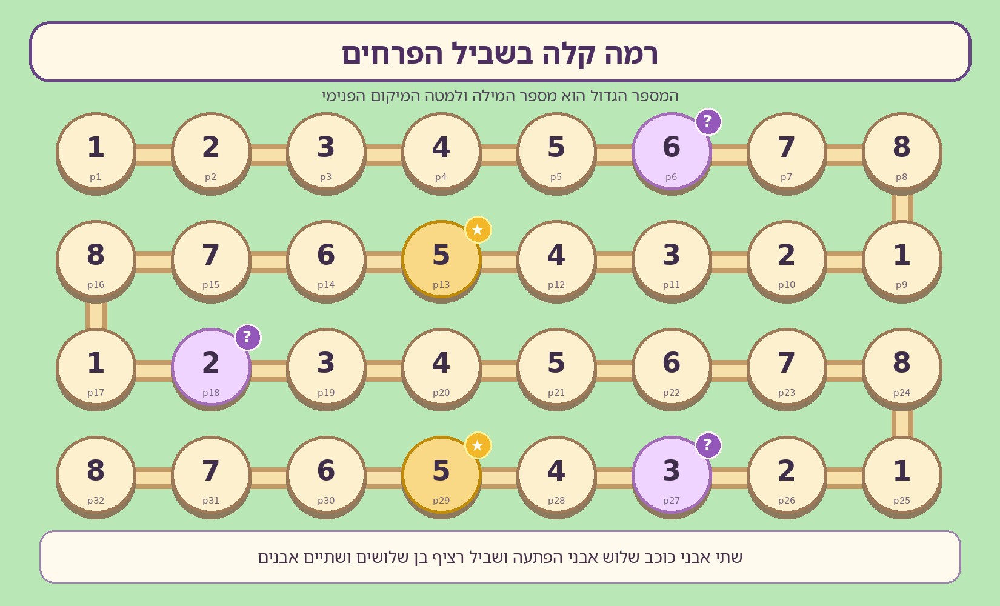
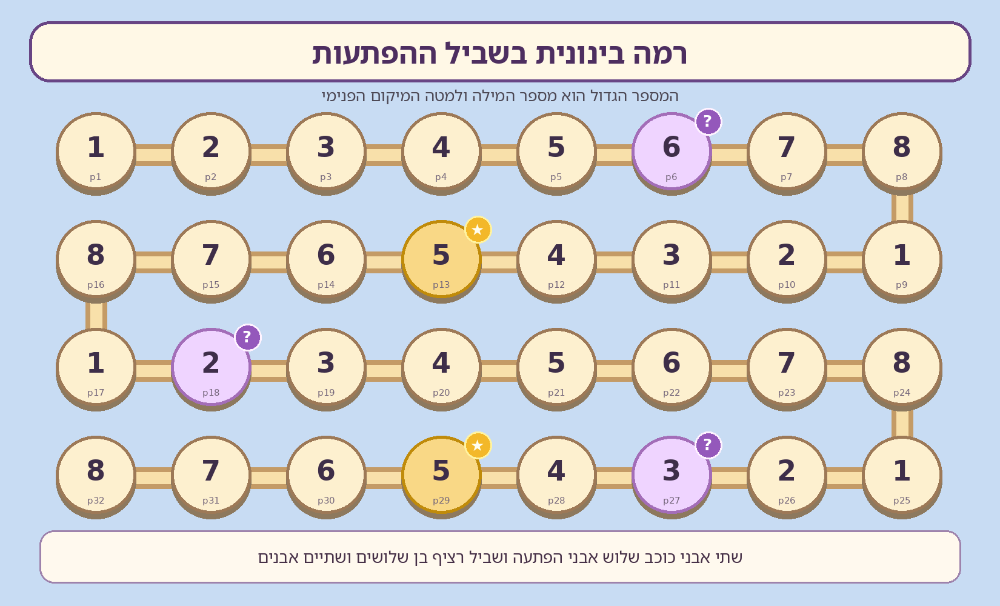
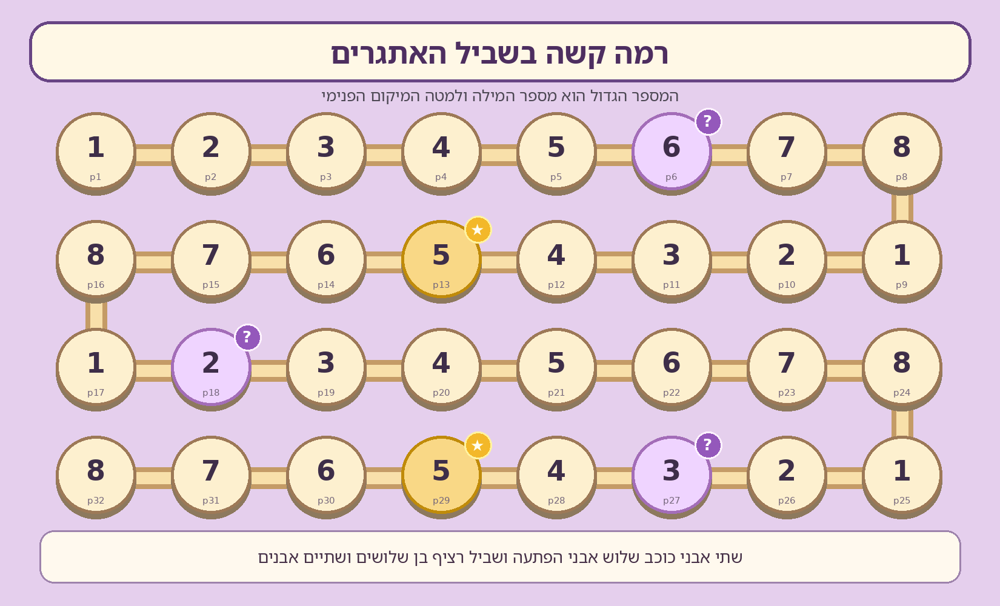
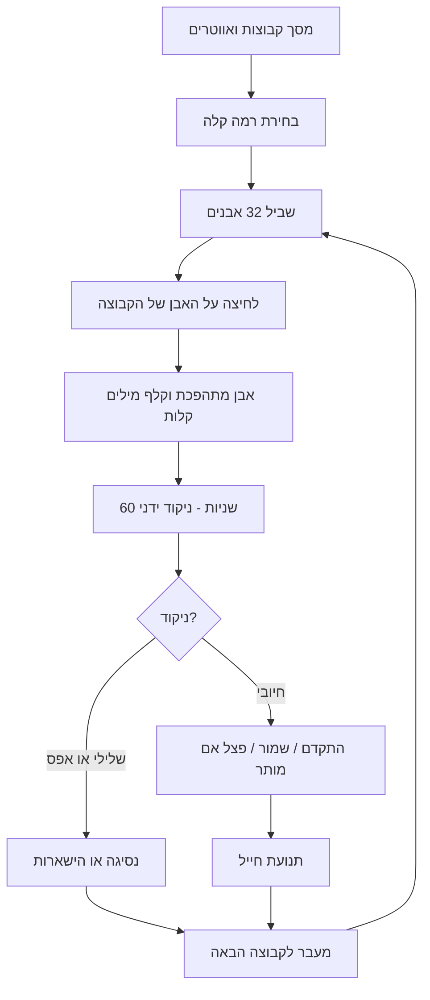
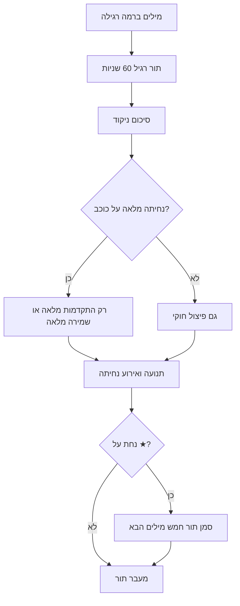
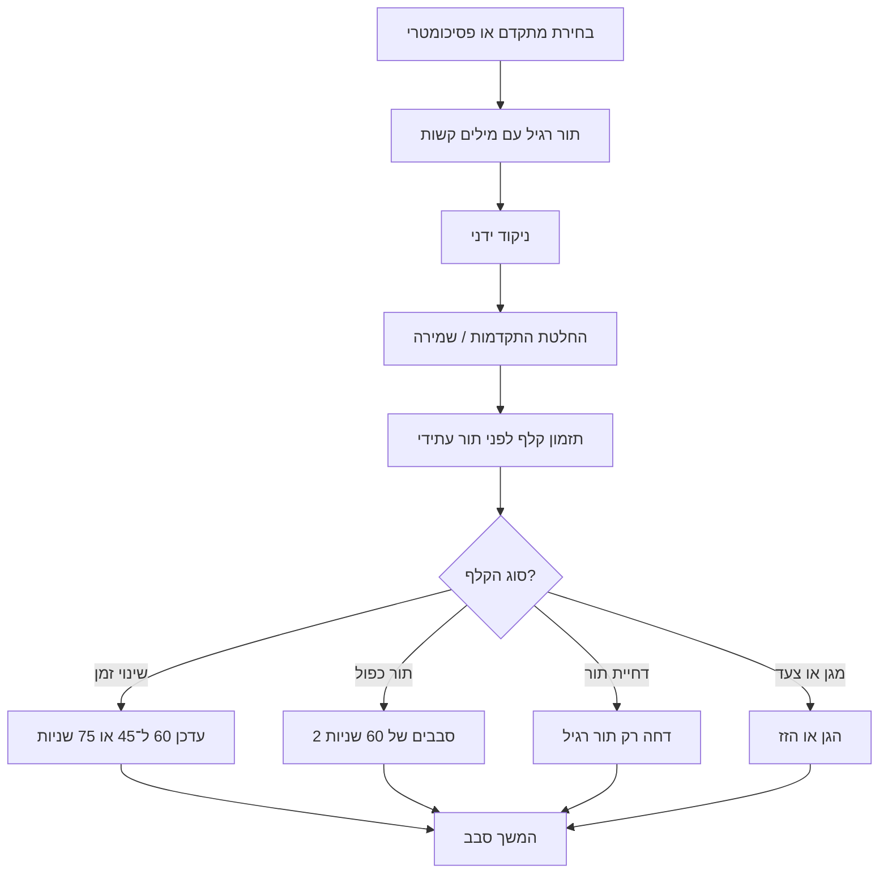

# הברקה 🎲 — תכנון רמות 01–03

**מסמך Level Design להגשה | תאריך: 23.11.2026 | צוות: עדי פלצקי | פלטפורמה: Unity 2D למובייל**

> **מטרת המסמך:** לתכנן את שלוש הרמות שאחרי ה־Tutorial ברמה שמאפשרת למתכנת להתחיל לממש. זהו **אפיון**, לא הוכחה שהמשחק מאוזן. תכנון רמת ההדרכה נמצא במסמך `tutorial-level-00.md`.

## 1. הרעיון שמחבר בין כל הרמות

הברקה הוא משחק מילים חברתי בעברית, שבו 2–3 קבוצות משחקות סביב **טלפון משותף אחד**. המגדיר מסביר מילים בלי לומר אותן או מילים מהשורש שלהן. השחקנים, קובעים אם הניחוש נכון ולוחצים על `נכון +1`, `דלג -1` או מסמנים הגדרה לא חוקית.

**ארבע רמות התכנון:** הדרכה (`00`), קל (`01`), בינוני (`02`) וקשה (`03`). בוחרים רמה בתחילת המשחק — אין צורך לפתוח רמות קודמות כדי לשחק ברמה קשה.

| מאפיין | Level 01 — קל | Level 02 — בינוני | Level 03 — קשה |
|---|---|---|---|
| קהל יעד | משפחות, ילדים מגיל 8 | משפחות וחברים מנוסים מעט | שחקנים מנוסים, סטודנטים |
| חבילת מילים ראשית | קל | רגיל | פסיכומטרי מאתגר |
| חלופה לבחירה | — | מתקדם | מתקדם |
| מאפיין קושי | מושגים מוחשיים ומוכרים | מושגים חברתיים ומופשטים | מילים נדירות והגדרות מדויקות |
| קלפי כוח | השפעות פשוטות, בלי התקפה | תוספת התקפה והגנה | גם קלף נדיר לדחיית תור |
| זמן תור רגיל | **60 שניות** | **60 שניות** | **60 שניות** |
| מטרה | להבין את הקצב והבחירות | לתכנן שימוש בקלפים | להתמודד עם מילים קשות בלי לפגוע בקצב |

**החלטת עיצוב:** הקושי לא עולה בגלל שעון קצר יותר. נשמור על 60 שניות, כדי שהמילים והאסטרטגיה הן שייצרו את ההבדל. ארבע חבילות המילים מהאפיון (קל, רגיל, מתקדם, פסיכומטרי) נשמרות; בחירת חבילה שונה מרמת ברירת המחדל היא אפשרות בהגדרות ולא רמה חמישית.

### הקשר לסקר השוק

הקהל המרכזי הוא משפחות וחברים, ולא רק חובבי משחקי מחשב. משחקים דומים כבר משתמשים בלוח, קבוצות וקלפי מילים. לכן מה שמבדל את הברקה הוא **השילוב בין ניחושים חברתיים, בחירת התקדמות/שמירה וקלפי כוח**. יש לשמור שהקלפים לא יאטו את המשחק או יכריעו במקום היכולת המילולית.

## 2. חוקים קבועים לשלוש הרמות

- **לוח:** 32 אבני דרך בגן מאויר. כל אבן מציגה מספר **1–8**, והמספור חוזר ארבע פעמים. השחקן רואה את מספר המילה; התוכנה שומרת מיקום פנימי `1–32`.
- **תחילת משחק:** כל חייל מתחיל במיקום `0`, לפני האבן הראשונה, ומתחיל את תורו הראשון בלחיצה על אבן `START`.
- **התחלת תור:** מעבירים את הטלפון למגדיר; רק האבן של הקבוצה שבתור לחיצה. בלחיצה האבן זוהרת, מתהפכת במשך כ־0.5 שניות ונפתח קלף בן **8 מילים**. הטיימר מופעל עם תחילת ההגדרה, לא בזמן האנימציה.
- **המילה שנבחרת:** בכל קלף מסבירים רק את המילה שמספרה זהה למספר שעל האבן שבה החייל עומד **בתחילת התור**. המספר אינו משתנה באמצע התור.
- **ניקוד:** תשובה נכונה `+1`; דילוג או הגדרה לא חוקית `-1`. אין האזנה או בדיקה אוטומטית; כל השיפוט ידני.
- **תנועה:** ניקוד חיובי מאפשר התקדמות, שמירה או פיצול חוקי. ניקוד שלילי מחזיר לאחור עד מיקום `0`, ללא הפעלת אירועים בדרך. ניקוד `0` לא מזיז.
- **החלטה:** עד **15 שניות**; אם לא בוחרים, מתקדמים בכל הנקודות. אם התקדמות מלאה הייתה **נוחתת** על כוכב `5 מילים`, לא ניתן לפצל, אלא רק להתקדם בכל הנקודות או לשמור את כולן.
- **שמירה:** 1–2 נקודות → קלף בסיסי; 3–4 → משופר; 5 ומעלה → נדיר. ההמרה מתבצעת בתחילת התור הבא של **אותה קבוצה**. אי אפשר לחסוך בשני תורות רצופים; אפשר להחזיק עד שני קלפים שמורים.
- **חטיפת מילה אחרונה:** אם 60 השניות נגמרו **באמצע הגדרת מילה**, כל הקבוצות יכולות לנחש **ללא הגבלת זמן**. הקבוצה הראשונה שמנחשת נכון מקבלת **צעד מיידי אחד**; אפשר לסיים ידנית עם `אין ניחוש`. אין חטיפה אם הזמן נגמר בין מילים.
- **כוכב `5 מילים`:** נחיתה **קדימה** עליו גורמת לכך שהתור הבא של אותה קבוצה יוחלף בתור של 5 מילים, ללא טיימר. כל הקבוצות מנחשות; הראשונה שמנחשת מילה מזכה את קבוצתה בצעד מיידי. אם אף קבוצה לא מצליחה, המגדיר יכול ללחוץ `זרוק קלף`: הקבוצה המגדירה מפסידה **נקודה אחת (צעד אחורה)**, והקלף נחשב לאחד מחמשת הקלפים. אין קלף חלופי ואין שמירת נקודות מהתור המיוחד. נסיגה מוגבלת למיקום `0` ואינה מפעילה אירוע.
- **הפתעה `?`:** מופעלת מייד רק בנחיתה קדימה, לא במעבר או בנסיגה. אירוע הפתעה נוסף באותה שרשרת תנועה לא מופעל שוב.
- **סיום:** לאחר שחייל מגיע לאבן 32, יתר הקבוצות משלימות אותו מספר תורות. הקבוצה שהגיעה הכי רחוק מנצחת; בשוויון יש סיבוב הכרעה מילולי ללא קלפי כוח (הפרטים האחרונים עדיין לא הוכרעו).

### החישובים שמנוע המשחק צריך לבצע

**מספר המילה לפי מיקום:**

\[
w(p)=((p-1)\bmod 8)+1
\]

הסבר: מחסירים 1 כדי להתחיל את המחזור מ־0, מחשבים שארית בחלוקה ל־8, ומוסיפים 1 כדי לחזור לספרות 1–8. לדוגמה, \(w(13)=5\).

**ניקוד נטו של תור:**

\[
S=N_{\text{נכון}}-N_{\text{דילוג}}-N_{\text{פסילה}}
\]

הסבר: כל הצלחה מוסיפה נקודה, וכל דילוג או פסילה גורעים נקודה אחת.

**מיקום חדש לאחר התקדמות או קנס:**

\[
p_{\text{חדש}}=\min(32,\max(0,p_{\text{ישן}}+S))
\]

הסבר: מוסיפים את הניקוד למיקום, אבל לא מאפשרים לרדת מתחת ל־0 או לעבור את סוף המסלול 32. בפיצול משתמשים רק בחלק הנקודות שהוקצה להתקדמות.

**לוגיקת חסימת הפיצול:**

\[
\text{חסום}=(S>0)\land (p_{\text{חדש}}\in\{13,29\})
\]

הסבר: הפיצול חסום **רק** אם התקדמות *מלאה* עם הניקוד החיובי מסתיימת בדיוק באחת משתי אבני הכוכב. מעבר על פני הכוכב אינו חוסם פיצול. בפועל הקוד יבדוק גם אם לקבוצה מותר לחסוך בתור הזה.

## 3. הלוח: מיקומים מדויקים

**בחרנו הצעה אחת קבועה לשלוש הרמות**, כדי שההשוואה ביניהן תהיה הוגנת ולא כל ההבדל ינבע ממזל. אפשר לשנות בעתיד לאחר בדיקות משחק.

| סוג | מיקומים פנימיים (`p`) | המספרים שרואים |
|---|---|---|
| ★ חמש מילים | **13, 29** | **5, 5** |
| ? הפתעה | **6, 18, 27** | 6, 2, 3 |
| אבני 5 רגילות | 5, 21 | 5, 5 |
| התחלה | 0 | START |
| סיום | 32 | 8 ודגל סיום |

**סידור האבנים המדויק:** ארבע שורות של שמונה אבנים ב'נחש': שורה 1 — משמאל לימין `p1..p8`; שורה 2 — מימין לשמאל `p9..p16`; שורה 3 — משמאל לימין `p17..p24`; שורה 4 — מימין לשמאל `p25..p32`. מעבר בין שורות מבוצע דרך שביל מעוגל; החייל עובר לפי `p`, ולא לפי קרבת האבנים בציור.

| רמה | תרשים למימוש |
|---|---|
| קל |  |
| בינוני |  |
| קשה |  |

בכל התרשימים **הספרה הגדולה היא מספר המילה** ו־`p#` הקטן הוא המיקום הפנימי למתכנת. הסמלים `★` ו־`?` אינם מסתירים את המספר שעל האבן.

## 4. Level 01 — קל: 'צעד ראשון בשביל'

**יעד:** לתת לשחקנים צעירים או חדשים חוויה עצמאית ראשונה, שבה הם מגדירים מילים מוכרות ולומדים להחליט אם להתקדם או לחסוך.

**מילים:** חבילת `easy`, למשל מטרייה, חלון, כדור, כלב, בית, ספר, רכבת, כרית. כמות להדגמת אב־טיפוס: **12 קלפים × 8 מילים** בקובץ JSON. כל קלף נשאר במבנה של שמונה שורות.

**קלפי כוח (הצעת איזון מדויקת):**

| מחיר נקודות שנשמרו | קלף שיישלף | השפעה | מתי מופעל |
|---|---|---|---|
| 1–2 | `צעד מתנה` — 100% | +1 לאותה קבוצה | בעת הפעלה |
| 3–4 | `תוספת זמן` — 100% | 75 שניות במקום 60 | לפני תחילת תור רגיל |
| 5+ | `תור כפול` — 100% | שני סבבי 60 שניות, ציון משותף | לפני תחילת תור רגיל |

**למה דווקא אלה?** הקלפים כולם מועילים לקבוצה עצמה ולא דורשים לזכור התקפות ותגובות. זה לא משנה את חוק מחירי הקלפים; רק את סוגי הקלפים הזמינים ברמה הקלה.

**אירועים בלוח:** `?` במיקומים 6, 18, 27 שולף `התקדם צעד` (75%) או `חזור שתי אבנים` (25%). `★` ב־13 וב־29 מפעיל תור חמש מילים בתור הבא.

**דוגמה מלאה לתור:**

1. הכחולים מתחילים ב־`p9`. על האבן כתוב `1`, לכן בכל קלף מסבירים מילה מספר 1.
2. במהלך 60 שניות התקבלו 4 הצלחות ודילוג אחד:

   \[
   S=4-1=3
   \]

   הסבר: ארבע הצלחות מוסיפות ארבע נקודות ודילוג אחד מוריד נקודה.
3. בהתקדמות מלאה הקבוצה תגיע למיקום:

   \[
   p=9+3=12
   \]

   הסבר: מוסיפים את כל הנקודות למיקום 9. מיקום 12 אינו כוכב, ולכן הפיצול מותר.
4. הכחולים בוחרים `התקדם 2, שמור 1`. החייל מגיע ל־`p11` והנקודה נשמרת.
5. בתחילת התור הבא של **הכחולים** הנקודה מומרת לקלף בסיסי `צעד מתנה`. אין שמירה נוספת באותו תור.

**תרשים זרימה של הרמה:**

**בדיקות לרמה:** בקבוצה בת 4 שחקנים לפחות, התור הראשון צריך להיות ברור בלי הסבר מהמפתחת; הדגימה צריכה להראות ששחקנים מבינים מהו `+1`, `-1` ומה פירוש שמירת נקודות. **סף מוצע לבדיקת שימוש**: לפחות 80% מהקבוצות מתחילות תור ללא עזרה נוספת.

## 5. Level 02 — בינוני: 'ההפתעה שבדרך'

**יעד:** לשמור על קצב משחק מהיר, אבל להוסיף מושגים מופשטים והחלטות על שימוש בקלפי התקפה והגנה.

**מילים:** חבילת `regular`, למשל הרפתקה, אחריות, התלהבות, פשרה, יוזמה, הסתגלות, השפעה, ציפייה. אפשר לבחור את חבילת `advanced` כחלופת תוכן, בלי לשנות חוקים. חבילת הדוגמה כוללת **12 קלפים × 8 מילים**.

**קלפי כוח:**

| מחיר נקודות | אפשרויות שליפה | השפעה |
|---|---|---|
| 1–2 | `צעד מתנה` 75%, `מגן` 25% | +1 או חסימת התקפה אחת |
| 3–4 | `תוספת זמן` 50%, `קיצור זמן` 50% | +15 שניות לעצמך או −15 שניות ליריב |
| 5+ | `תור כפול` 100% | שני סבבים רגילים של 60 שניות, ציון אחד |

**הפעלת קלפים:** תוספת/קיצור זמן מופעלים **לפני** הפעלת הטיימר. מגן מגיב להתקפה ונהרס לאחר שימוש. כל קבוצה יכולה לספוג **התקפה אחת לכל היותר בסבב תורות מלא**. כללי התנועה וההפתעות זהים לרמה הקלה.

**דוגמה מלאה לתור עם כוכב:**

1. הכחולים נמצאים ב־`p9`, ומגדירים בכל קלף מילה מספר `1`.
2. שש הצלחות ושתי טעויות נותנות:

   \[
   S=6-2=4
   \]

   הסבר: השש מוסיפות שש נקודות ושתי הטעויות גורעות שתיים.
3. התקדמות מלאה תוביל ל־:

   \[
   p=9+4=13
   \]

   הסבר: מיקום 13 הוא אבן שמסומנת **5** וגם `★`, ולכן אי אפשר לפצל את ארבע הנקודות.
4. הממשק מציג `התקדם 4` או `שמור 4`. הכחולים בוחרים להתקדם ונוחתים על `★`.
5. לאחר תור היריבים, בתור הבא של הכחולים מתחיל **תור חמש מילים**. בכל אחד מחמישה קלפים מוצגת המילה החמישית. כל הקבוצות מנחשות ללא טיימר ומקבלות צעד מיידי על כל תשובה ראשונה.

**תרשים זרימה של הרמה:**

**בדיקות לרמה:** קיצור זמן של 15 שניות ייתן **45** שניות (ולא 60); מגן יבטל התקפה אחת; ניסיון להתקיף קבוצה שכבר ספגה התקפה בסבב ייחסם; הפיצול ב־`p9 + 4` ייחסם; מעבר דרך `p13` ללא נחיתה לא יפעיל כוכב.

## 6. Level 03 — קשה: 'מילים למומחים'

**יעד:** לאתגר את אוצר המילים, מהירות הניסוח והבחירות האסטרטגיות של שחקנים מנוסים. **אין ניקוד אוטומטי ואין קיצור טיימר מובנה**.

**מילים:** ברירת המחדל היא חבילת `psychometric`, עם מילים פחות שכיחות כגון אצטלה, אמתלה, תואנה, למכביר, שלהי, תעתוע וכמיהה. מי שמעדיף אתגר קשה פחות בוחר `advanced` עם מילים כגון הסתייגות, עמימות, היקש ופרדוקס. **חשוב:** הרשימות הן הצעת אוצר מילים, לא רשימת תדירות רשמית של הבחינה הפסיכומטרית; צריך לבדוק שכל מילה מובנת ונכונה לפני השקה. כל אחת משתי החבילות כוללת **12 קלפים × 8 מילים** לדוגמה.

**קלפי כוח:**

| מחיר נקודות | אפשרויות שליפה | השפעה |
|---|---|---|
| 1–2 | `צעד מתנה` 50%, `מגן` 50% | עזרה מידית או הגנה |
| 3–4 | `תוספת זמן` 50%, `קיצור זמן` 50% | +15 או −15 שניות לפני תור |
| 5+ | `תור כפול` 75%, `דחיית תור` 25% | תור כפול או דחיית **תור רגיל** אחד של יריב |

`דחיית תור` **לא מבטלת תור חמש מילים חובה**. אי אפשר להפעיל שני קלפי תור כפול באותו תור, ואין יותר מהתקפה אחת על אותה קבוצה בסבב. הסיכויים המופיעים בטבלה הם **הצעה ראשונית לאיזון**, לא תוצאות מדידה.

**דוגמה מלאה לתור קשה:**

1. הכחולים נמצאים ב־`p27`, שעליו מופיע `3`, ולכן המגדיר מסביר מילה 3 מכל קלף פסיכומטרי.
2. ארבע הצלחות ושני דילוגים נותנים:

   \[
   S=4-2=2
   \]

   הסבר: מקזזים שני דילוגים מארבע הצלחות.
3. אם יתקדמו בכל שתי הנקודות:

   \[
   p=27+2=29
   \]

   הסבר: מיקום 29 הוא אבן `5` עם `★`, ולכן הפיצול חסום. מותר להתקדם `2` או לשמור `2` (בתנאי שמותר לחסוך).
4. הכחולים בוחרים לשמור. הם נשארים ב־`p27`. בתחילת התור הבא שלהם יקבלו קלף **בסיסי** — לא נדיר, כי נשמרו רק 2 נקודות.
5. בתור הבא, אם יחזרו לקבל ניקוד חיובי, לא יוכלו לשמור שוב ברצף. המערכת תאפשר התקדמות בלבד בהתאם לחוק.

**תרשים זרימה של הרמה:**

**בדיקות לרמה:** כוכב מופיע רק על אבן `5`; קלף דחייה לא מבטל תור חמש מילים; אם מילה קשה מדי בתור רגיל יש `דלג -1`, ובתור חמש מילים יש `זרוק קלף` עם קנס לקבוצה המגדירה; שתי התקפות אינן מצטברות על קבוצה באותו סבב; כל הקלפים והניקוד נשארים בשליטת השחקנים.

## 7. ממשק ואנימציות — זהים לכל הרמות

| מסך / רכיב | מה רואים | פעולה | תגובת Unity |
|---|---|---|---|
| `GameSetup` | בחירת מצב, רמה וקבוצות | בוחרים 2/3 קבוצות ורמה | נטענים חוקי הרמה וחבילת המילים |
| `AvatarSetup` | שמונה אווטרים מוכנים + עורך | בוחרים גלריה או יוצרים | אווטר לכל קבוצה נשמר מקומית |
| `BoardView` | שביל אבנים מאויר, דשא, פרחים, חיילים | לוחצים על האבן של הקבוצה הפעילה | זוהר, היפוך אבן, פתיחת קלף |
| `WordCardView` | קלף 8 מילים, שורה אחת מודגשת | המגדיר מסביר; לוחץ נכון/דלג | ניקוד משתנה, מופיע קלף הבא |
| `StealView` | המילה האחרונה + כפתורי קבוצות | מסמנים מי ניחש ראשון / אין ניחוש | בונוס צעד מיידי, **בלי טיימר** |
| `ScoreView` | הצלחות, דילוגים, ניקוד נטו | בוחרים התקדמות/שמירה/פיצול | תצוגה מקדימה, חסימת פיצול אסור |
| `PowerCardView` | קלפים שמורים ודרגות | מפעילים קלף בזמן החוקי | החלה של השפעה וצריכת קלף |
| `SpecialWordView` | 5 מילים, כולן מהשורה `5` | מסמנים מי ניחש ראשון או לוחצים `זרוק קלף` | לזוכה +1 צעד; בזריקה לקבוצה המגדירה −1 צעד, ללא טיימר |
| `EndView` | תוצאות וחיילים בסיום | משחק חדש / משחק חוזר | ניקוי נתוני משחק קודם |

**סגנון גרפי:** שביל אבנים עם גימור מצויר, צבעים שמחים, אבן `5 מילים` עם כוכב ברור, אבן הפתעה עם `?`, אווטרים מצחיקים שבוחרים או יוצרים מראש. אנימציות קצרות (כ־0.5 שניות להיפוך אבן), כפתורים גדולים וקריאים, אפשרות דילוג על אנימציה. לחיצה על אבן של קבוצה אחרת **לא** פותחת תור ולא מזיזה חייל.

**האווטר:** בשלב הראשון לכל קבוצה אווטר אחד המשמש כחייל. יצירה עצמית מבוססת על בחירת צורת גוף, עיניים, פה, כובע/אביזר וצבע. יש גם שמונה דמויות מוכנות כדי לא להאריך את תחילת המשחק.

## 8. מימוש מוצע ב־Unity

| רכיב | תפקיד |
|---|---|
| `LevelDefinition` (`ScriptableObject` או JSON) | שם הרמה, חבילת מילים, קלפי כוח ומשקלים |
| `BoardManager` | 32 מיקומים, מסלול נחש, תנועה ונחיתה |
| `StoneTile` | מספר גלוי, סמל, לחיצה והנפשת היפוך |
| `WordDeckManager` | טעינת קלפים, בחירת מילה לפי מספר האבן ומניעת חזרות |
| `TurnManager` | קבוצה פעילה, תור רגיל/מיוחד, חטיפה ומעבר תורות |
| `ScoreManager` | ניקוד אנושי, פיצול, שמירה וקלפי כוח |
| `PowerCardManager` | שליפה לפי דרגה, הפעלה והתנגשויות בין קלפים |
| `AvatarCreator` | אווטר מוכן או הרכבה מחלקים ושמירה מקומית |
| `GameUIController` | מעבר מסכים וחיווי חזותי |

**קובצי נתונים מצורפים:**

- `data/board-32.csv` — כל אבן: מיקום פנימי, שורה, עמודה, מספר גלוי וסוג אירוע.
- `data/level-config.json` — כללי המשחק המשותפים + מיפוי קלפי כוח והסתברויות מדויקות לכל רמה.
- `data/word-cards-examples.json` — ארבע חבילות מילים (קל, רגיל, מתקדם, פסיכומטרי), **12 קלפים של 8 מילים בכל חבילה**. זהו **מאגר הדגמה**, לא כמות סופית למשחק מלא.

**כללי הקוד:** כל הרמות מפעילות אותו מנוע משחק; משתנים רק `wordPack`, התפלגות קלפי הכוח והמראה החזותי. כל שליפה אקראית נעשית לפי המשקלים המוגדרים, ולא לפי בחירה חופשית של המתכנת בזמן ריצה. בהתחלת תור יש לבדוק `pendingFiveWords`, `pendingSavedPoints`, `attackCountThisRound` ומצב הקלפים.

## 9. בדיקות קבלה משותפות

| # | קלט / מצב | תוצאה צפויה |
|---|---|---|
| 1 | מיקום `p8` ומעבר ל־`p9` | מספר האבן משתנה מ־8 ל־1 |
| 2 | `p13` או `p29` | כתוב 5 ויש סמל ★; `p5` ו־`p21` הן אבני 5 רגילות |
| 3 | נחיתה קדימה על `p18` | מופעל קלף הפתעה; מעבר דרך `p18` לא מפעיל |
| 4 | לחיצה על אבן שאינה של הקבוצה שבתור | אין היפוך או פתיחת קלף |
| 5 | על `p27` מתחילים תור | נבחרת מילה 3 בכל קלף |
| 6 | 5 נכונות, 2 דילוגים, פסילה אחת | ניקוד נטו 2 |
| 7 | `p9` עם 4 נקודות | יעד `p13` ★; פיצול חסום |
| 8 | `p9` עם 5 נקודות | יעד `p14` רגיל; מעבר דרך `p13` לא חוסם פיצול |
| 9 | שמירת 2 נקודות | בתחילת התור הבא נשלף **קלף בסיסי** |
| 10 | שמירה בשני תורות רצופים | האפשרות נחסמת בתור השני |
| 11 | השעון מסתיים באמצע מילה | כל הקבוצות יכולות לנחש ללא טיימר |
| 12 | השעון מסתיים בין מילים | לא נפתח מצב חטיפה |
| 13 | קבוצה נוחתת קדימה על `p29` | התור הבא שלה הוא חמש מילים, לא אותו התור |
| 14 | שלוש קבוצות בתור חמש מילים | כל השלוש רשאיות לנחש; רק הראשונה מקבלת צעד |
| 15 | מגן מופעל בתגובה לקיצור זמן | ההתקפה מתבטלת והקלף נצרך |
| 16 | שתי התקפות על אותה קבוצה בסבב | ההתקפה השנייה חסומה |
| 17 | קלף דחייה מול תור חמש מילים חובה | התור המיוחד אינו מתבטל |
| 18 | ניקוד שלילי שמוביל אל מתחת ל־0 | מיקום סופי `0`, בלי הפעלת הפתעות בנסיגה |
| 19 | חייל הגיע ל־32 בסבב לא מושלם | ממתינים ליתר הקבוצות עם מספר תורות שווה |
| 20 | שחקנית משתמשת באווטר מוכן | האווטר נראה על הלוח בלי לעבור עורך אווטר |
| 21 | אף קבוצה לא מנחשת בתור חמש מילים | `זרוק קלף` מסיים את הניסיון ללא טיימר; לקבוצה המגדירה יורד צעד אחד |
| 22 | זורקים את הקלף החמישי בתור מיוחד | התור מסתיים לאחר חמישה קלפים; לא מחלקים קלף חלופי |
| 23 | קבוצה מגדירה במיקום `0` זורקת קלף | נשארת במיקום `0`, ללא הפעלת אירוע מיוחד |

## 10. איך בודקים שהרמות באמת שונות?

**בדיקת משתמשים מוצעת:** לשחק עם משפחות וקבוצות חברים, למדוד בכל רמה את מספר המילים שהוגדרו נכון, מספר הדילוגים, זמן המשחק הכולל, כמות קלפי הכוח והדקות שהוקדשו להחלטות. אלה יעדים לבדיקת שימוש — **לא תוצאות מדודות**.

| מדד | מה נצפה לראות |
|---|---|
| רמה קלה | יותר ניחושים מוצלחים ופחות דילוגים |
| רמה בינונית | תחרות מאוזנת, יותר שימוש מתוכנן בקלפים |
| רמה קשה | יותר דילוגים, אבל עדיין תנועה על הלוח והנאה |
| כל הרמות | הסברים קצרים, חוויית משחק משפחתית, ללא דומיננטיות של קלפים על פני ניחוש מילים |

**סיכון חשוב:** ברמה קשה השחקנים עלולים לצבור פחות צעדים, ולכן משחק של 32 אבנים עלול להיות ארוך מדי. כדי להמחיש זאת, נניח שכל תור יחד עם מעבר לוח לוקח 90 שניות בממוצע, ושתי קבוצות מתקדמות בממוצע בקצב שונה:

\[
T\approx \frac{32}{v}\cdot 2 \cdot \frac{90}{60}\ \text{דקות}
\]

הסבר: מחלקים 32 אבנים במספר הצעדים הממוצע לתור \(v\), מכפילים בשתי קבוצות וב־1.5 דקות לתור. זו **המחשה היפותטית**, לא סימולציה ולא מדידה; קלפים, תורות מיוחדים וקנסות יכולים לשנות את התוצאה.

| קצב משוער לתור לקבוצה | זמן משוער לשתי קבוצות |
|---|---|
| 2.5 צעדים | כ־39 דקות |
| 2 צעדים | כ־48 דקות |
| 1.5 צעדים | כ־64 דקות |

אם בדיקות יראו שהרמה הקשה ארוכה מדי, נבחן **אפשרות חדשה של משחק קצר**, אך לא נשנה כרגע את לוח 32 האבנים שסוכם.

## 11. מה סגור ומה עדיין מוצע?

**חוקים שאושרו:** קבוצות סביב טלפון אחד, הגדרה בלי שורש המילה, שיפוט ידני, 60 שניות, `+1/-1`, שמירת נקודות וקלפי כוח, 32 אבנים עם 1–8 חוזר, כוכב רק על חלק מאבני 5, חטיפה ללא מגבלת זמן, אפשרות לזרוק קלף בתור חמש מילים תמורת קנס של צעד אחד לקבוצה המגדירה, שביל אבנים ואווטרים.

**הצעות בתכנון הזה, לא החלטות סופיות:** מיקומי הכוכבים `13,29`, מיקומי ההפתעות `6,18,27`, הרכבי הקלפים והסיכויים בכל רמה, התחלת תור דרך אבן START, בחירת הפסיכומטרי כברירת מחדל לקשה, גלריית שמונה אווטרים, יעדי זמן הרמות ומספר קלפי הדוגמה.

**פתוח להחלטה לפני פיתוח מלא:** פירוט סיבוב הכרעה; הרחבת מאגר המילים למשחקים שלמים; איזון קלפים ומשכי משחק; הגדרה מלאה של קלפי עזרה במצב ביחד. **נסגר:** אם אף קבוצה לא מנחשת בתור חמש מילים, ניתן לזרוק את הקלף ולקנוס את הקבוצה המגדירה בצעד אחד.

### מקורות תכנון

מסמך `FormalElements.md` והמסמך `Market_Research (2).md` שסופקו לפרויקט, יחד עם `tutorial-level-00.md`. המחקר היה מחקר שולחני; לא בוצעו עדיין בדיקות שחקנים או מדידת איזון בפועל.
