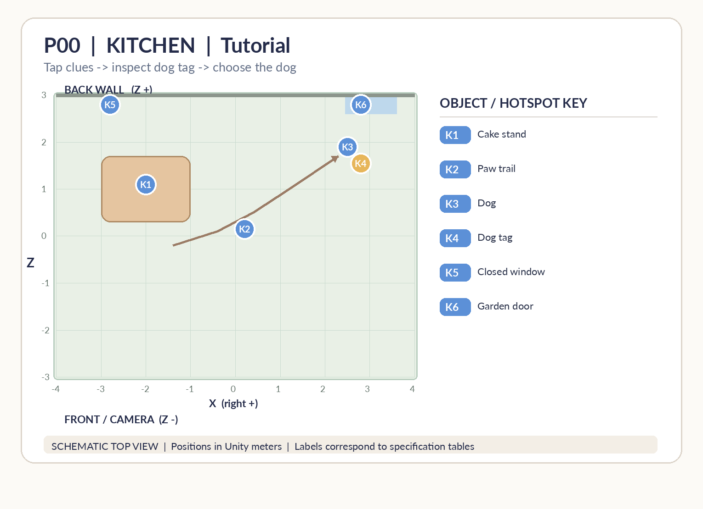
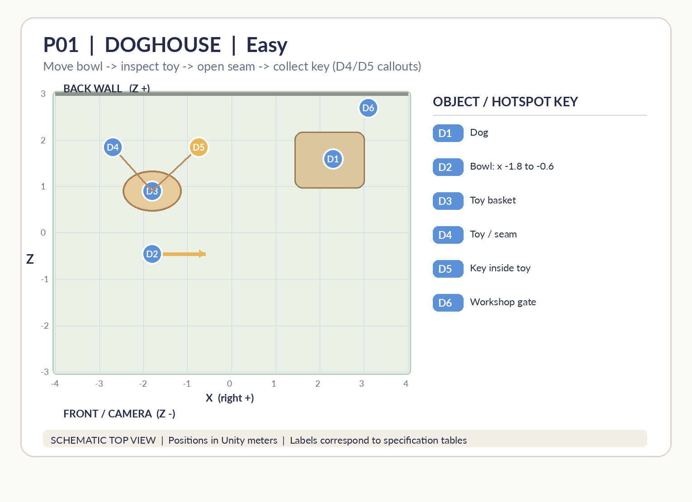
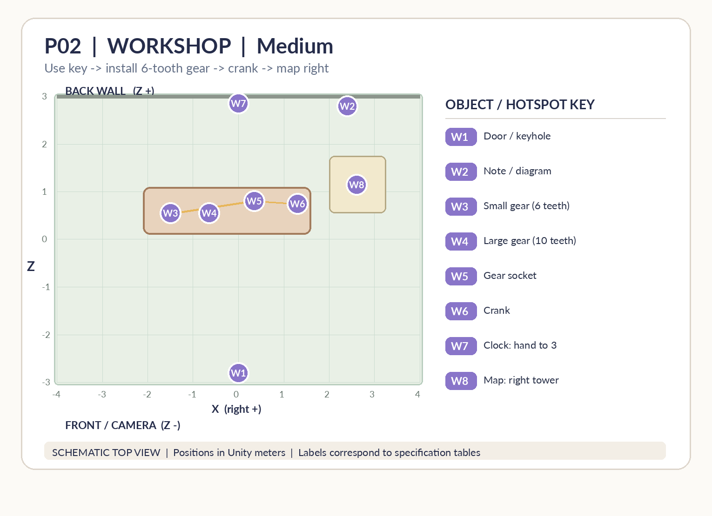
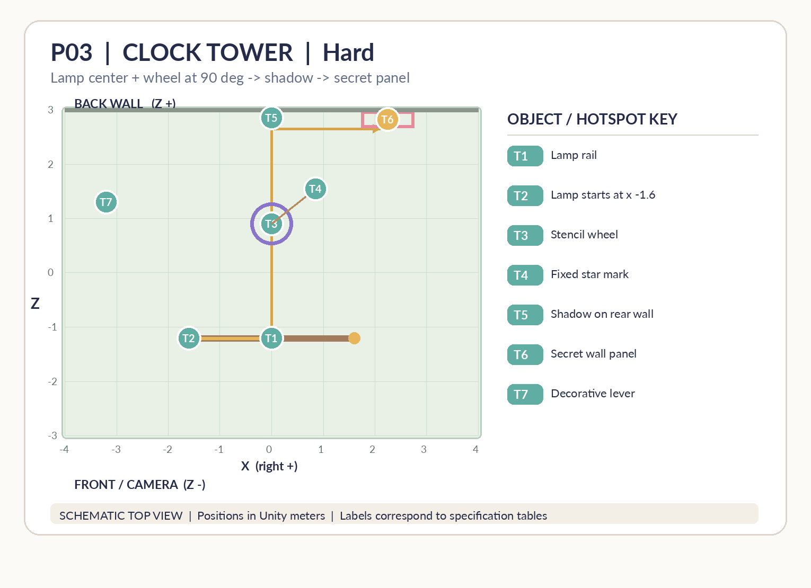
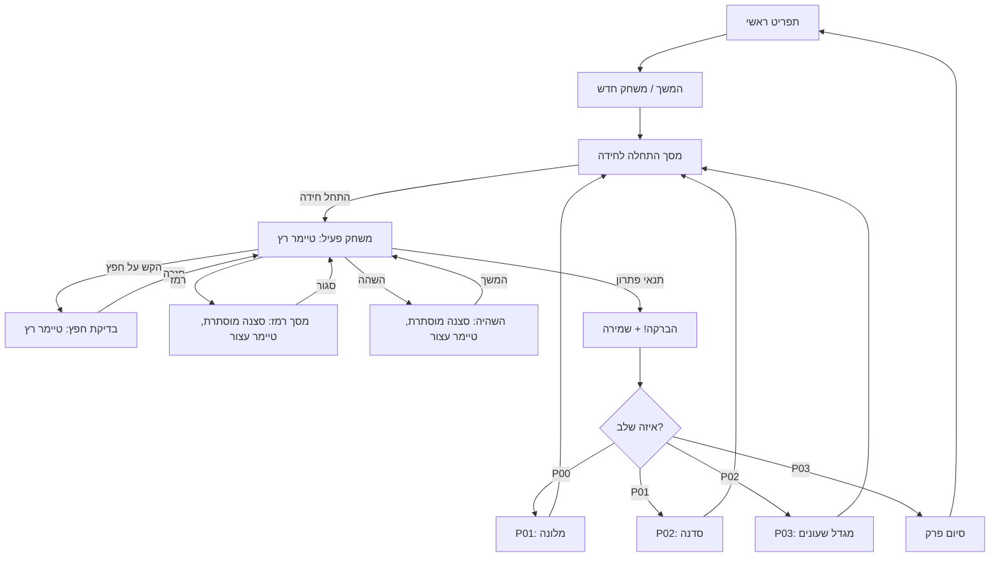

# הברקה 💡 — אפיון פיתוח מפורט: ארבע רמות ראשונות

**גרסה:** 1.0 | **תאריך:** 24.11.2026 | **מנוע:** Unity 3D, טלפון Android | **סטטוס:** תכנון מוכן למימוש אב־טיפוס; טרם נבדק עם שחקנים

**תקציר:** משחק חידות תלת־ממדי לשחקן יחיד. בכל חידה חוקרים סצנה מוגבלת, מחברים פרטים ופותרים תעלומה. הפתרון מקשר באופן עלילתי לחידה הבאה. ארבע הרמות: `P00 → P01 → P02 → P03 → ChapterComplete`. הסיפור המוצע: **העוגה שנעלמה → הכלב → המפתח → השעון → המעבר הנסתר**.

## 0. חוקים משותפים — מימוש פעם אחת לכל ארבע הרמות

| רכיב | הגדרה מדויקת |
|---|---|
| שליטה | הקשה (`Tap`) על אובייקט עם Collider; גרירה (`Drag`) רק לאורך מסילה/ציר מסומן; במסך בדיקת חפץ מסובבים אותו בגרירה אופקית בשלבים. אין הליכה חופשית. |
| מצלמה | לכל חדר מצלמה כללית קבועה ותקריבים מתוסרטים. בהקשה על אובייקט — מעבר לתקריב שלו למשך 0.35 שניות. כפתור 'חזרה' מחזיר למצב כללי. |
| אינטראקציה | כל פריט פעיל מקבל הדגשת מסגרת קלה במגע; פריט תפאורה לא משנה מצב. אזורי הקשה צריכים להיות גדולים מספיק למסך טלפון (יעד: לפחות 44×44 יחידות מסך). |
| שגיאה | פעולה לא נכונה אינה מאפסת את החידה; טקסט קצר מתחת למסך למשך כ־2 שניות. ניתן לנסות שוב מיד. |
| רמזים | שלושה רמזים קבועים לכל חידה, לפי סדר. מסך הרמז מסתיר את הסצנה. אין עונש או חסימה. |
| זמן | מתחיל בלחיצה על 'התחל חידה', עם חשיפת הסצנה; נעצר בהשהיה, בעת הצגת מסך רמז או ברקע; מסתיים רק כשהחידה נפתרת. אין דדליין. |
| מדידת זמן | `solveSeconds` הוא סכום פרקי הזמן שבהם החידה פעילה (ראו נוסחה להלן). `firstSolveSeconds` נשמר בניסיון הראשון בלבד; ריפליי לא מחליף אותו בטבלת חברים. `hintCount` נשמר בנפרד. |
| שמירה | לאחר כל אירוע שמשנה מצב (`Flag`, מיקום מסילה, רמז, פתיחת פריט) מתבצעת שמירה מקומית. כשחוזרים, כל החפצים חוזרים למצב האחרון. |
| סיום חידה | נועלים אינטראקציות ל־1.5 שניות, מציגים 'הברקה!', הסבר קצר, זמן ומספר רמזים; רק אחר כך כפתור 'לחידה הבאה'. |
| שיתוף חברים | רק במסך נפרד. מציגים `אתגר 01` וכו' ורק את זמני אותן חידות שהשחקן כבר פתר. אין שמות, חפצים או פתרונות של רמות עתידיות. ב־MVP מסך הדירוג מדומה ומסומן כך; לא מתחזה לשרת אמיתי. |
| אופליין | כל ארבע החידות, הרמזים וההתקדמות עובדים בלי אינטרנט. דירוג אמיתי מחייב שרת ונמצא מחוץ ל־MVP. |

**חישוב זמן הפעילות:**

\[
T_{\mathrm{solve}} = \sum_{i=1}^{n} (t_{i,\mathrm{end}} - t_{i,\mathrm{start}})
\]

בכל מקטע מחשבים זמן סיום פחות זמן התחלה. מחברים רק מקטעים שבהם השחקן באמת בתוך החידה; זמן השהיה ורמזים לא נכללים.

**קואורדינטות:** בכל חדר הרצפה נמצאת ב־`y=0`. הציר `x` גדל ימינה, הציר `z` גדל לכיוון הקיר האחורי, הציר `y` גדל למעלה. גודל חדר פנימי טיפוסי: `x ∈ [-4,4]`, `z ∈ [-3,3]`, במטרים של Unity. נקודות בטבלאות הן **מרכזי Prefab** (אלא אם צוין אחרת). המצלמה הכללית המוצעת: `(0, 3.6, -7.5)`, מביטה לנקודה `(0, 1.1, 0.5)`; אפשר לשנות מעט FOV כדי למנוע חיתוך בטלפון, אך לא לשנות מיקומי פתרון.

**הזרימה בכל חידה:** `Intro → Playing → Inspecting / Hint / Paused → Solved → Result → Next`. במסך `Inspecting` אפשר לסובב חפץ; במצב `Hint`/`Paused` אי־אפשר ללחוץ על אובייקטים בסצנה.

---

## P00 — Tutorial: המטבח והעוגה שנעלמה

**מטרה:** לזהות שהכלב לקח את העוגה מתוך שני פרטים משלימים. **מיומנות:** הקשה, בדיקה וסיבוב חפץ, הסקת מסקנה. **משך יעד לבדיקת משתמשים:** 1–3 דקות (לא מגבלת זמן).

**הצגת סיפור:** 'העוגה של החגיגה נעלמה. מי לקח אותה?' ברקע מטבח בהיר, מגש עוגה ריק וכלב שמציץ בדלת לגינה.

### מפת הסצנה

| מזהה | חפץ | מיקום `(x,y,z)` | מה רואים / מה אפשר לעשות |
|---|---|---|---|
| `K_CakeStand` | מגש עוגה ריק על שולחן | `(-2.0,0.95,1.1)` | לחיצה מראה שאריות קצפת; אין חפץ להרמה |
| `K_PawTrail` | חמישה סימני כפות על הרצפה | מרכז `(0.2,0.02,0.15)` | לחיצה מדגישה לכיוון דלת הגינה; Decals לאורך `(-1.3,-0.2)→(1.8,1.6)` בצירי `x,z` |
| `K_Dog` | הכלב ליד הדלת | `(2.5,0,1.9)` | לחיצה פותחת תקריב של הקולר |
| `K_Tag` | תליון בקולר | *ילד של* `K_Dog`, מרכז `(0,0.8,-0.1)` בקואורדינטות מקומיות | בתקריב: גרירה אופקית של כ־120px הופכת את התליון 180°; בגב שלו שארית קצפת |
| `K_Window` | חלון סגור | `(-2.8,1.5,2.8)` | פריט בדיקה לא־מכריע; תגובה 'החלון סגור' |
| `K_Door` | דלת הגינה | `(2.8,0,2.8)` | סגורה למעבר שחקן; הופכת למעבר הבא לאחר פתרון |

### רצף הפעולות המדויק

1. נפתח מסך כותרת. לחיצה על **'התחל חידה'** חושפת את המטבח ומתחילה מדידת זמן; בועת הדרכה: 'הקישי על פריט כדי לבדוק אותו'.
2. הקשה על `K_CakeStand` → תקריב וכתובית 'נשארו רק פירורים וקצפת'. לחיצה על 'חזרה' חוזרת למצלמה הראשית; נשמר `cakeSeen=true` (לצורך לימוד בלבד).
3. הקשה על `K_PawTrail` → הדגשת חמש כפות בסדר מהשולחן לדלת, חצי שנייה בין זוג צעדים. כתובית 'מישהו עבר מהשולחן לגינה'. נשמר `tracksSeen=true`.
4. הקשה על `K_Dog` → תקריב הקולר. גרירה על `K_Tag` משמאל לימין מעל 120px → התליון מסתובב 180°; מתגלה קצפת. נשמר `tagFrostSeen=true`.
5. כפתור **'מי לקח את העוגה?'** פותח שלוש אפשרויות: **כלב / רוח / אדם**. לפני שני דגלי הראיות `tracksSeen` ו־`tagFrostSeen` האפשרויות לא נשלחות; מופיעה הודעה 'חסרים פרטים — בדקי עוד משהו בסצנה'.
6. בחירה ב'רוח' או 'אדם' אחרי חקירת הראיות → 'לא כל הרמזים מתאימים להסבר הזה', בלי לאפס התקדמות. בחירה ב'כלב' → `P00Solved=true`.
7. אנימציית 'הברקה!', הסבר: 'סימני הכפות הובילו לדלת, ועל התליון של הכלב נשארה קצפת'. הכלב רץ לכיוון המלונה. כפתור 'בעקבות הכלב' פותח `P01`.

**תנאי הצלחה מדויק:** `tracksSeen && tagFrostSeen && selectedAnswer == DOG`.

**שלושת הרמזים (לפי סדר):** (1) 'בדקי גם את הרצפה'; (2) 'למי יכולים להשתייך סימני הכפות?'; (3) 'אפשר לבדוק גם את הצד השני של התליון'.

**הערת עיצוב:** לא חייבים ללחוץ על כל פריט במטבח. רק *שני רמזים רלוונטיים* נדרשים לפתרון, כדי שלא יהפוך לחיפוש חובה של כל החפצים.

---

## P01 — קל: המלונה והצעצוע המצלצל

**מטרה:** לגלות מפתח מוסתר בתוך צעצוע של הכלב. **מיומנות חדשה:** גרירת פריט על מסילה וסיבוב חפץ בתקריב. **משך יעד:** 2–4 דקות.

**הצגת סיפור:** 'הכלב לא הביא את העוגה למלונה. אבל בכל פעם שהוא נוגע בצעצוע שלו נשמע צלצול מתכתי.' המצלמה מציגה מלונה, קערת מים וסל צעצועים.

### מפת הסצנה

| מזהה | חפץ | מיקום `(x,y,z)` | מה רואים / מה אפשר לעשות |
|---|---|---|---|
| `D_Dog` | כלב ליד המלונה | `(2.3,0,1.6)` | לחיצה → הכלב מביט בסל הצעצועים; רמז חזותי בלבד |
| `D_Bowl` | קערה ליד הסל | `(-1.8,0.2,-0.45)` | גרירה לאורך X, מ־`-1.8` עד `-0.6` (1.2 מ׳); חושפת חלק מהסל |
| `D_Basket` | סל צעצועים | `(-1.8,0,0.9)` | לחיצה אחרי הזזת הקערה → מתקרבים לסל |
| `D_Toy` | עצם בד כתומה בסל | מקומית לסל, מרכז `(-0.15,0.35,0)` | הקשה מפיקה צלצול + כתובית '[צלצול מתכתי]'; עוברת למסך בדיקה |
| `D_ToySeam` | תפר כתום בגב הצעצוע | ילד של `D_Toy` | נראה רק אחרי סיבוב הצעצוע **180°** סביב Y; גרירת לשונית התפר כ־80px כלפי מטה פותחת כיס |
| `D_Key` | מפתח קטן בעל חריטת גלגל שיניים | נמצא בכיס של הצעצוע | מופיע רק אחרי פתיחת התפר; הקשה אוספת אותו למלאי |
| `D_WorkshopGate` | שער סדנה ברקע הגינה | `(3.1,0,2.7)` | פעיל למעבר רק אחרי איסוף המפתח |

### רצף הפעולות המדויק

1. 'התחל חידה' → שעון מתחיל והכלב קופץ ליד המלונה. המטרה על המסך: **'מה מצלצל בתוך הצעצוע?'**
2. אם לוחצים על הסל כשהקערה עדיין חוסמת אותו → הודעה 'הקערה מסתירה חלק מהסל'. אם לוחצים על הכלב → הוא מצביע באפו לכיוון הסל.
3. גוררים את הקערה ימינה לפחות 1.0 מ׳; המערכת מצמידה אותה לנקודת סוף המסילה `x=-0.6`. הסל נעשה נגיש. נשמר `bowlMoved=true`.
4. לוחצים על הסל, ואז על העצם. נשמע צלצול; כתובית תואמת זמינה גם כשהצליל כבוי. נפתח תקריב חפץ.
5. גוררים אופקית על העצם עד סיבוב מצטבר של 180° (אפשר בשתי גרירות); התפר נראה. נשמר `seamVisible=true`.
6. גוררים את לשונית התפר למטה לפחות 80px → הפתיחה ננעלת במצב פתוח; המפתח מתגלה.
7. מקישים על המפתח → `keyCollected=true`; רואים חריטת גלגל שיניים ותקריב קצר של שער הסדנה עם סמל תואם. מופיעה 'הברקה!' ונפתח מעבר ל־`P02`.

**תנאי הצלחה מדויק:** `bowlMoved && seamVisible && seamOpened && keyCollected`. אי־אפשר לאסוף מפתח לפני שנגלה הכיס.

**משוב לשגיאות:** גרירה לצד הלא נכון מוחזרת לתחילת המסילה; ניסיון לפתוח תפר לפני סיבוב החפץ מציג 'נסי לבדוק גם את הצד השני'; לחיצה על השער לפני האיסוף: 'עדיין לא מצאת מה פותח את השער'.

**שלושת הרמזים:** (1) 'הכלב מסתכל על משהו ליד הקערה'; (2) 'אולי יש משהו שמסתתר מאחורי הקערה'; (3) 'הצעצוע מצלצל; אפשר להפוך אותו ולבדוק את התפר'.

**למה קל:** בכל רגע יש פעולה פיזית אחת ברורה; לא צריך לזכור רמז מרמה קודמת. התנועה מוגבלת לציר אחד, וסיבוב החפץ מודרך.

---

## P02 — בינוני: הסדנה והמנגנון שעצר

**מטרה:** לתקן מנגנון קטן, לפענח את הרמז שהוא יוצר ולהסיק שהיעד הבא הוא מגדל השעונים. **מיומנות חדשה:** בדיקת התאמה בין חלקים והצלבת מידע משני מקורות. **משך יעד:** 4–7 דקות.

### מפת הסצנה

| מזהה | חפץ | מיקום `(x,y,z)` | פעולה |
|---|---|---|---|
| `W_Door` | דלת הסדנה | `(0,0,-2.8)` | זום כניסה נעול עד שימוש במפתח |
| `W_Lock` | חור מנעול עם חריטת גלגל שיניים | `(0.65,1.0,-2.75)` | גרירת `D_Key` מהמלאי אל החור פותחת דלת |
| `W_Note` | פתק שרטוט על הקיר האחורי | `(2.4,1.45,2.8)` | הקשה מגדילה תרשים: גלגל חסר + משפט 'המחוג מצביע על מקום, לא על שעה' |
| `W_SmallGear` | גלגל שיניים קטן, 6 שיניים | `(-1.5,1.05,0.55)` | אפשר לגרור לתושבת; החלק הנכון |
| `W_LargeGear` | גלגל גדול, 10 שיניים | `(-0.65,1.05,0.55)` | אפשר לנסות; לא מתאים בגודל, חוזר למגש |
| `W_GearSocket` | תושבת לגלגל בעל 6 שיניים | `(0.35,1.12,0.8)` | רק `W_SmallGear` ננעל במקומו |
| `W_Crank` | ידית סיבוב | `(1.3,1.0,0.75)` | גרירה של 90° בכיוון השעון מפעילה המנגנון אם הגלגל הותקן |
| `W_Clock` | שעון קיר תקוע | `(0.0,1.85,2.85)` | לאחר הפעלה המחוג מצביע בדיוק לספרה **3** (ימינה) |
| `W_Map` | מפת העיירה על לוח | `(2.6,1.1,1.15)` | שלוש נקודות לחיצות: משמאל מזרקה, באמצע מאפייה, מימין מגדל שעון |

### רצף הפעולות המדויק

1. בתחילת החידה דלת נעולה, המלאי מציג את המפתח שהושג ב־`P01`. גוררים אותו אל `W_Lock` (אזור קליטה בקוטר כ־80px) → המפתח נצרך; דלת נפתחת; המצלמה עוברת לסדנה. רק עכשיו מוצגים יתר החפצים.
2. לוחצים על ידית `W_Crank` לפני התקנת גלגל → הידית לא זזה; הודעה 'משהו חסר במנגנון'.
3. לוחצים על הפתק `W_Note` → תקריב ציור התושבת בעלת שש השיניים והמשפט 'המחוג מצביע על מקום, לא על שעה'. נשמר `noteRead=true`, אבל **אינו תנאי קשיח** לפתרון.
4. בוחנים את שני הגלגלים. גוררים את הגדול לתושבת → אינו נכנס ומוחזר עם טקסט 'הוא גדול מדי'. גוררים את הקטן לתושבת → הוא ננעל; נשמר `smallGearInstalled=true`.
5. גוררים את הידית למרחק 90° בכיוון השעון → אנימציה של סיבוב הגלגל, צלצול קצר, השעון מראה מחוג יחיד על **3**. נשמר `clockActivated=true`. כתובית '[שלושה צלצולים]'.
6. לוחצים על מפת העיירה: שלוש תמונות/אייקונים ניתנים לבחירה, בלי שמות שנחשפים מראש. השחקן מחבר את המידע: מחוג לימין = האפשרות הימנית במפה. לחיצה על **המגדל הימני** מסיימת את החידה.
7. 'הברקה!' → הסבר: 'המחוג אינו מציג שעה — הוא מצביע למיקום הימני במפה, למגדל השעונים'. נשמר בתיק הרמזים ציור קצר של **מנורה במרכז מסילה וכוכב בראש גלגל** לקראת הרמה הבאה. מעבר `P03`.

**תנאי הצלחה:** `doorOpen && smallGearInstalled && clockActivated && mapChoice == CLOCK_TOWER`.

**משוב לשגיאות:** בחירת מזרקה/מאפייה לפני הפעלת השעון → 'עוד אין לך כיוון'; אחרי הפעלה → 'נסי לחשוב על כיוון המחוג'; בלי אובדן זמן מעבר להמשך המשחק הפעיל. שימוש במפתח על חפץ לא מתאים → הוא חוזר למלאי.

**שלושת הרמזים:** (1) 'הידית לא עובדת כי חסר חלק'; (2) 'השווי בין מספר השיניים של התושבת לגלגלים'; (3) 'מה אומר מחוג שמצביע ימינה על המפה?'.

**למה בינוני:** יש פריט מטעה אחד (גלגל גדול), שתי תחנות פתרון (תיקון ואז הסקה) והמידע מפוצל בין שעון למפה. אין מבחן ידע חיצוני.

---

## P03 — קשה: מגדל השעונים והחץ שבצל

**מטרה:** לגלות מעבר נסתר בעזרת שילוב של מנורה על מסילה, גלגל תבנית מתכוונן וצל מוקרן. **מיומנות חדשה:** להחיל תרשים קודם על סביבה חדשה ולהבין את ההבדל בין הצורה עצמה לצל שלה. **משך יעד:** 5–10 דקות.

### מפת הסצנה

| מזהה | חפץ | מיקום `(x,y,z)` | פעולה |
|---|---|---|---|
| `T_LampRail` | מסילה קדמית עם שלושה מעצורים | מרכז `(0,0.8,-1.2)` | שלושה מיקומי X בלבד: `-1.6,0,+1.6` |
| `T_Lamp` | פנס על המסילה | מצב התחלתי `(-1.6,1.05,-1.2)` | גרירת הפנס בין שלושת המיקומים; למטרה נדרש האמצעי `x=0` |
| `T_StencilWheel` | גלגל עם חור בצורת חץ וסימון כוכב | `(0,1.45,0.9)` | לחיצה פותחת תקריב; גרירה מסובבת לצעדים של `90°`: `0/90/180/270` |
| `T_TowerMark` | כוכב קבוע מעל הגלגל | `(0,2.25,1.0)` | רמז חזותי: צריך ליישר אליו את הכוכב שעל הגלגל; הזווית הנכונה `90°` |
| `T_ArchiveNote` | הדף שנשמר בתיק הרמזים מסוף P02 | נפתח דרך כפתור מחברת, ללא מיקום בחדר | ציור 'פנס במרכז מסילה + כוכב מעל גלגל', לא מספק קואורדינטות |
| `T_ShadowWall` | קיר אחורי שעליו מוקרן צל | מרכז `(0,1.5,2.85)` | כשהפנס במרכז והגלגל ב־90°, נוצרת צללית חץ ימינה |
| `T_SecretPanel` | לוח סודי על הקיר האחורי מימין | `(2.25,1.2,2.82)` | לפני ההקרנה אינו לחיץ; לאחריה מופיע חריץ ונגיעה פותחת אותו |
| `T_DecorLever` | ידית ישנה על קיר שמאל | `(-3.2,1.3,1.3)` | לחיצה מפיקה רעש ולא משנה מצב; מסר 'הידית חלודה ואינה קשורה למנגנון הזה' |

### רצף הפעולות המדויק

1. 'התחל חידה' → המצלמה מציגה חדר שעון קטן; האור מהפנס מגיע לקיר, אבל לא מצביע על דבר. הודעה: 'יש כאן דלת שלא רואים'. מחברת הרמזים מסומנת כזמינה.
2. לחיצה על המחברת מציגה את השרטוט שנמצא בסדנה: סמל פנס באמצע שלוש תחנות וסמל כוכב בחלק העליון. זהו רמז עלילתי, לא חובה טכנית לקרוא אותו.
3. גוררים את `T_Lamp` על המסילה עד למעצור האמצעי (Snap ל־`x=0`). העברת הפנס לצדדים מייצרת צל מפוזר ולא מועיל; אין נעילה על פתרון שגוי.
4. מקישים על הגלגל `T_StencilWheel` וגוררים אופקית. כל שינוי 90° מציג זווית אחרת של החץ והכוכב. ב־**90°** הסימון שעל הגלגל מתיישר עם הכוכב שמעליו.
5. כאשר `lampSlot==CENTER && wheelAngle==90`, המערכת מציגה `T_ShadowArrow` (Prefab צל מתוסרט, ולא סימולציית פיזיקה מורכבת): חץ על הקיר האחורי המצביע ימינה אל החריץ בלוח.
6. לוחצים על `T_ShadowWall` → כתובית 'הצל מצביע למקום מסוים בקיר'. רק אחרי הצגת החץ, ה־Collider של `T_SecretPanel` מופעל.
7. נוגעים ב־`T_SecretPanel` → לוח סודי נפתח. מאחוריו נמצאים סרט העוגה ופתק: 'לא כל מה שנעלם הלך לאיבוד. מי רצה שתגיעו עד לכאן?' — סוף הפרק, בלי לחשוף את זהות משאיר הרמזים.
8. מופיעה 'הברקה!', שומרים `ChapterComplete=true`, מציגים סיכום זמן ורמזים לכל ארבע החידות וכפתור **'חזרה לתפריט'**. הפרק הבא טרם פותח.

**תנאי הצלחה מדויק:** `lampSlot==CENTER && wheelAngle==90 && shadowSeen && secretPanelOpened`.

**משוב לשגיאות:** לוח סודי לא לחיץ לפני הקרנת החץ; סיבוב לא נכון מציג צל לא מכוון; הפנס נצמד רק לשלושה מעצורים, כדי למנוע בעיית דיוק של תנועות מגע. לחיצה על ידית הדקורציה אינה משבשת דבר.

**שלושת הרמזים:** (1) 'חזרי לשרטוט שמצאת בסדנה'; (2) 'בדקי את שלוש נקודות העצירה של הפנס'; (3) 'הכוכב שעל הגלגל צריך להצביע אל הכוכב הקבוע'.

**למה קשה:** השחקן משתמש בפרט מהחידה הקודמת, משלב שתי התאמות שונות ורק אז מפרש את התוצאה — *מה שהצל מצביע עליו*, לא את הגלגל עצמו.

---

## 5. תרשים זרימת הפרק ומערכת מצבים

## 6. חוזה מימוש ל־Unity (ללא AI)

**מבנה פרויקט מוצע:** `Scenes/MainMenu`, `Scenes/P00_Kitchen`, `Scenes/P01_Doghouse`, `Scenes/P02_Workshop`, `Scenes/P03_ClockTower`, `UI/Hud`, `UI/HintOverlay`, `UI/ResultScreen`.

| רכיב C# | אחריות נקודתית |
|---|---|
| `PuzzleStateManager` | שומר מערך דגלים לכל חידה; בודק תנאי פתרון; מונע הפעלת סיום פעמיים |
| `InteractableObject` | ID קבוע + Collider + סוג פעולה: `Tap`, `DragAxis`, `RotateSnap`, `Collect` |
| `ObjectFocusController` | זום לתקריב וחזרה; לא משנה את מצב החידה אלא רק תצוגה |
| `PuzzleInputRouter` | Raycast ממצב מגע; מנתב לאובייקט הפעיל; חוסם אינטראקציות בזמן Overlay |
| `HintController` | מונה 0–3, מציג טקסט קבוע לפי רמה וסדר, עוצר שעון ומסתיר סצנה |
| `ActiveTimeTracker` | צובר זמן רק בזמן `Playing/Inspecting`; שומר `firstSolveSeconds` פעם אחת |
| `LocalSaveService` | שומר ל־JSON מקומי: מזהה חידה, דגלים, מצב פנס/גלגל, רמזים, זמן פעיל |
| `ProgressionController` | פותח רק את השלב הבא ברצף; עדכון תפריט ומסך הסיום |
| `LeaderboardPreview` | מסך UI מדומה ובו `P00...P03`, זמנים לדוגמה המסומנים 'הדגמה'; אינו שולח נתונים לרשת |

**אירועים מומלצים:** `OnObjectInspected(id)`, `OnObjectMoved(id, snappedTarget)`, `OnItemCollected(id)`, `OnAnswerChosen(id)`, `OnPuzzleSolved(puzzleId)`, `OnTimerPause(reason)`, `OnSaveRequested()`.

**חשוב:** לכל חידה `state` משלה. מידע שאפשר להעביר בין חידות מוגבל ל־`Inventory` (למשל המפתח בין P01 ל־P02) ול־`Notebook` (השרטוט בין P02 ל־P03). לאחר שימוש במפתח הוא נצרך. אין לאפשר לשחקן להיכנס ל־P03 בלי להפעיל את מנגנון P02.

## 7. בדיקות קבלה — חובה לפני ההגשה ואחרי המימוש

| # | מבחן | תוצאה צפויה |
|---|---|---|
| 01 | P00: לחיצה על רוח אחרי שתי ראיות | אין מעבר; הודעת ניסיון שגוי |
| 02 | P00: בחירה בכלב בלי לבדוק תליון | אין מעבר; 'חסרים פרטים' |
| 03 | P00: שני רמזים + כלב | פתרון, הסבר, פתיחת P01 |
| 04 | P00: חלון סגור בלבד | אין התקדמות בעלילה |
| 05 | P01: לחיצה על סל כשקערה במקומה | הסל חסום |
| 06 | P01: הסטת קערה ימינה 1.2 מ׳ | סל נגיש; מיקום נצמד ל־x=-0.6 |
| 07 | P01: ניסיון פתיחת תפר לפני סיבוב | אין פתיחה; מופיע רמז קצר |
| 08 | P01: סיבוב 180°, פתיחת תפר, איסוף מפתח | P01 נפתרת, מפתח נכנס למלאי |
| 09 | P02: שימוש במפתח על חפץ אחר | מפתח נשאר במלאי; הדלת לא נפתחת |
| 10 | P02: הכנסת גלגל גדול לתושבת | חוזר למגש; אין הפעלה |
| 11 | P02: סיבוב הידית לפני הכנסת גלגל | לא קורה דבר מלבד משוב תקלה |
| 12 | P02: גלגל קטן + סיבוב ידית 90° | השעון מצביע ימינה לספרה 3 |
| 13 | P02: בחירת מזרקה במקום מגדל | אין מעבר |
| 14 | P02: הפעלה ובחירת מגדל | P02 נפתרת, נוסף שרטוט למחברת |
| 15 | P03: פנס בצד שמאל וגלגל 90° | אין חץ תקין |
| 16 | P03: פנס במרכז וגלגל 180° | אין חץ תקין |
| 17 | P03: פנס במרכז + גלגל 90° | נוצר חץ שמצביע ללוח סודי |
| 18 | P03: לחיצה על לוח סודי לפני הצל | לא מתרחש דבר |
| 19 | P03: חץ נראה + לחיצה על לוח | לוח נפתח; ChapterComplete |
| 20 | בכל חידה: שלושה רמזים | הרמז הרביעי חסום; אין ענישה |
| 21 | בכל חידה: השהיה בזמן גרירה | שעון נעצר, חפץ נשאר במיקום תקין |
| 22 | בכל חידה: חזרה מאפליקציה ברקע | שעון לא צבר זמן רקע; שחזור מצב אחרון |
| 23 | בכל חידה: פתיחת מסך רמז | הסצנה מוסתרת; זמן נעצר |
| 24 | פתרון ראשון ואז ריפליי מהיר יותר | השיא האישי מתעדכן; זמן פתרון ראשון אינו משתנה |
| 25 | מסך דירוג לפני פתיחת P03 | אין תיאור, שם או תמונה של P03 |
| 26 | ניסיון מעבר ל־P03 ללא פתרון P02 | חסום |
| 27 | לחיצה כפולה על פתרון | נקודות/מעבר/זמן נרשמים פעם אחת |
| 28 | כל רמה ב־Android ללא רשת | אפשר לפתור ולשמור משחק מקומי |

## 8. הנחיות עיצוב ובדיקות משתמשים

- **עיצוב:** תלת־ממד מאויר, צבעוני ומזמין. הדגשות אינטראקטיביות עדינות בלבד; לא לצבוע את כל הרמזים בצהוב מראש.
- **נגישות:** כתוביות לכל צליל חשוב, טקסט קריא, מצב ללא צלילים, כפתור חזרה קבוע, ללא פעולת מגע מדויקת במיוחד.
- **בדיקת הוגנות:** המשתמש צריך לומר *למה* הפתרון הגיוני, לא רק למצוא על מה ללחוץ. אם כולם פותרים בניסוי וטעייה — החידה צריכה שכתוב.
- **מדדים לבדיקה:** שיעור השלמת חידה, נקודות שבהן נתקעים, שימוש ברמזים, זמן פתרון, רצון להמשיך ולפתור את הבאה. אין להסיק שיפור קוגניטיבי כללי מהצלחה במשחק.
- **בדיקה מעשית מומלצת:** 5–8 שחקנים ראשונים שאינם מכירים את הפתרונות; לרשום בעיות חזרתיות ולתקן קודם את החידות עם הכי הרבה בלבול.

### קבצים מצורפים

`../diagrams/P00-kitchen.png`, `P01-doghouse.png`, `P02-workshop.png`, `P03-clocktower.png` — תרשימי סצנה טכניים **מבט על** עם מזהי אובייקטים ומיקומים. ב־P01 סמלוני D4/D5 מוצגים כתוויות־הסבר ליד הסל; פיזית הם חלק מהצעצוע שבתוכו, כפי שמוגדר בטבלה. `../data/puzzle-data.json` — מזהי הרמות, האובייקטים, הקואורדינטות ותנאי ההצלחה להטמעה ראשונית. אלה אינם מודלים תלת־ממדיים ואינם קוד Unity מוכן להרצה.
