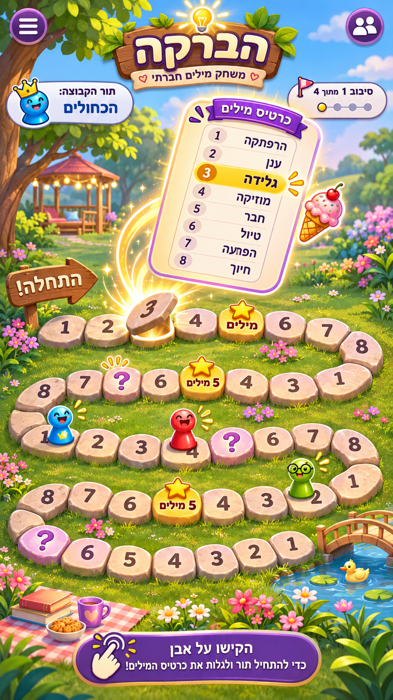
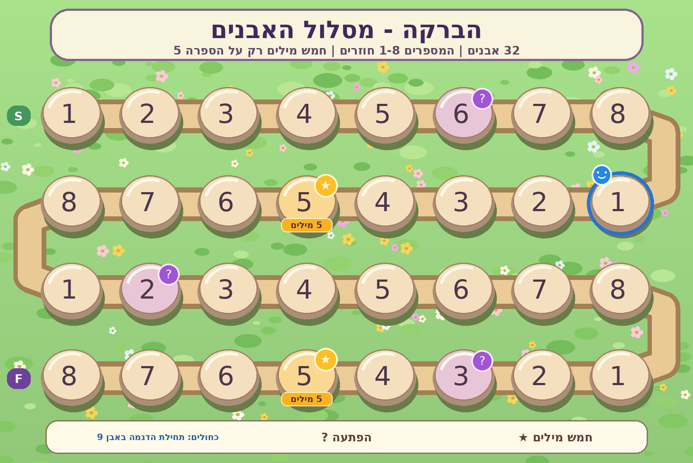
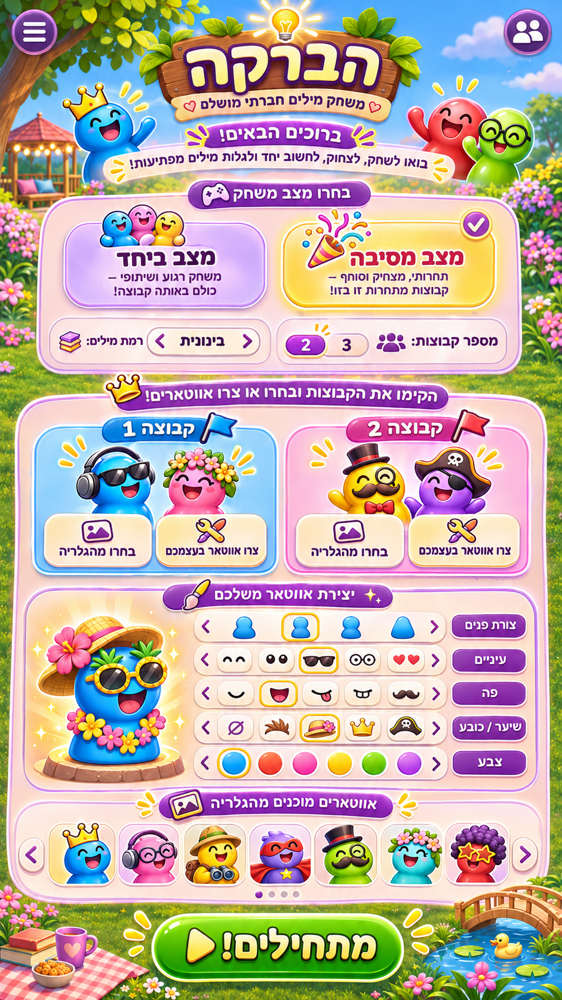
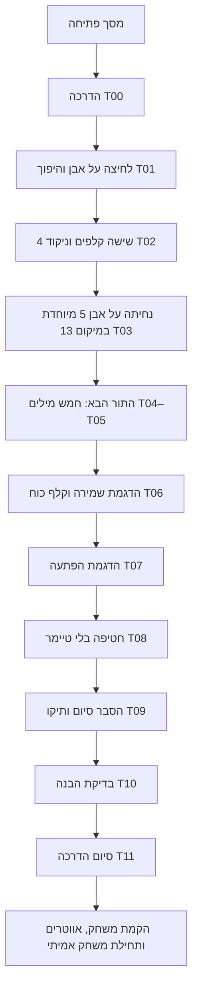

# הברקה 🎲 — Level 00: ההברקה הראשונה!

**סוג:** Tutorial אינטראקטיבי | **פלטפורמה:** Unity 2D במובייל | **גרסה:** 1.2 (23.11.2026)

**מטרה:** ללמד את חוקי המשחק דרך התנסות קצרה, בלי להעמיס הסברים. קהל היעד הוא משפחות וחברים דוברי עברית, כולל שחקנים בלי ניסיון בגיימינג.

**הבחנה:** חוקי המשחק המוסכמים מוצגים כרגיל. מיקומי המשבצות המיוחדות, האנימציות וההדגמות הם **הצעות למימוש ראשוני** שייבדקו עם שחקנים.

## 1. הרעיון והעיצוב

הלוח ייראה כמו **שביל אבנים מצויר בגינה צבעונית**: דשא, פרחים, שלטים וחיילים שהם אווטרים מצחיקים. לכל אבן מספר ברור בין 1 ל־8. האווירה שמחה ומשחקית, אבל הטקסט והכפתורים נשארים קריאים גם בטלפון קטן.

*התמונה היא השראה לסגנון ולא תרשים מדויק של סדר 32 האבנים. את מיקומי האבנים והאירועים קובעים לפי הסעיף הבא.*

**פעולת פתיחת תור:** רק האבן שעליה עומד החייל של **הקבוצה שבתור** תהיה לחיצה. בלחיצה היא תזרח, תתהפך ותפתח קלף מילים. המילה המתאימה למספר האבן תודגש. האנימציה תימשך כ־0.5 שניות ותהיה ניתנת לדילוג. במהלך התור עוברים בין קלפים בלי ללחוץ שוב על האבן.

**חשוב:** לחיצה על אבנים אחרות לא מזיזה חיילים ולא מדלגת על התקדמות. החייל זז רק לפי הניקוד והקלפים.

## 2. מבנה הלוח

בלוח יש **32 אבנים ממוספרות**, אבל השחקנים רואים רק את המספרים 1–8 שחוזרים ארבע פעמים. Unity שומרת גם מיקום פנימי מ־1 עד 32, לצורך תנועה וסיום משחק.

מספר המילה על אבן במיקום פנימי \(p\) הוא:

\[
w(p)=((p-1)\bmod 8)+1
\]

**למה?** מחסירים 1 כדי להתחיל לספור מ־0; שארית החלוקה ב־8 מחזירה אותנו לתחילת הסדרה אחרי כל שמונה אבנים; מוסיפים 1 כדי להציג לשחקן מספר מ־1 עד 8.

למשל: \(w(9)=1\) וגם \(w(13)=5\). לכן על אבן 13 כתובה הספרה **5**, ולא 13.

**מיקומי אבנים מיוחדות בהצעת התכנון:**

| סוג | מיקומים פנימיים | המספרים שרואים על האבנים |
|---|---|---|
| ⭐ חמש מילים | **13, 29** | **5, 5** |
| ❓ הפתעה | 6, 18, 27 | 6, 2, 3 |
| אבני 5 רגילות | 5, 21 | 5, 5 |

**למה דווקא כך?** יש רק ארבע אבנים שעליהן כתובה הספרה 5: \(5,13,21,29\). בחרנו שתיים מהן לאתגר, כדי שלא כל נחיתה על 5 תפעיל אותו. אין אבנים מיוחדות משני סוגים באותו מיקום. המיקומים הם **הצעה לבדיקה**, לא תוצאה של בדיקת איזון.

הכוכב מופעל **רק בנחיתה קדימה**, והתור הבא של אותה קבוצה הופך לתור חמש מילים. מעבר דרך האבן לא מפעיל אותו.

**תחילת משחק:** באפיון המקורי החייל מתחיל במיקום 0, לפני אבן 1. כדי לאפשר גם שם פתיחת תור בלחיצה, נוסיף **אבן START** לחיצה. בהצעת המימוש היא פותחת קלף עם מילה 1; הנוסחה שלמעלה מיועדת לאבנים 1–32 בלבד.

## 3. מסך הפתיחה והאווטרים

לפני המשחק, כל קבוצה תוכל לבחור **אווטר מוכן** או ליצור אווטר מצחיק משלה. בשלב הראשון יהיה **אווטר אחד לכל קבוצה**, המשמש גם כחייל שלה על הלוח.

*גם זו המחשת עיצוב: המפרט המחייב הוא רשימת הרכיבים להלן, לא מיקום הכפתורים שבתמונה.*

**מסך הקמת המשחק (`GameSetup`):** בחירת מצב מסיבה/ביחד, מספר קבוצות (2 או 3 במצב מסיבה), שמות קבוצות, רמת מילים ובחירת אווטרים.

- **אווטרים מוכנים:** גלריה של 8 דמויות משעשעות, למשל מלך עם כתר, פיראט, בלש עם זכוכית מגדלת ודמות עם משקפיים ענקיים.
- **יצירה עצמית:** בחירת צורת גוף/פנים, עיניים, פה, כובע או אביזר, וצבע. הדמות מתעדכנת בתצוגה מקדימה.
- **כפתורים:** `בחרו מהגלריה`, `צרו בעצמכם`, `שמור אווטר`, `מתחילים`.
- **התנהגות:** אווטר נשמר מקומית עם הגדרות הקבוצה; אפשר להשתמש באווטר מוכן בלי להיכנס לעורך.

לא נדרש AI, זיהוי פנים או העלאת תמונה. כדי שההתחלה לא תהיה ארוכה, יצירת אווטר היא **רשות** וניתן לבחור מוכן בלחיצה אחת. בהדרכה משתמשים בשני אווטרים קבועים; את יצירת האווטרים עושים לפני משחק אמיתי.

## 4. רצף מסכי ההדרכה

ההדרכה משתמשת בקבוצות מדומות, כחולים ואדומים. אפשר לדלג עליה, והיא **לא משפיעה על משחק אמיתי**. טיימרים מוסברים בהדרכה, אבל לא רצים בזמן קריאת ההסברים.

| מסך | פעולה של המשתמש | תגובת המערכת |
|---|---|---|
| **T00 — פתיחה** | לוחצים `בואו נלמד` | מציגים שביל אבנים ואווטרים לדוגמה |
| **T01 — פתיחת תור** | לוחצים על האבן של הכחולים במיקום 9 | האבן המסומנת **1** מתהפכת ונפתח קלף בן 8 מילים; מילה 1 מודגשת |
| **T02 — ניקוד** | מסמנים 5 פעמים `נכון +1` ופעם אחת `דלג -1` | מתקבל ניקוד נטו 4 |
| **T03 — החלטה** | בוחרים `התקדם 4` | החייל מגיע מאבן 9 לאבן 13, שעליה 5 וכוכב |
| **T04 — הכוכב** | לוחצים `הבנתי` | מסבירים שתור חמש המילים יהיה **בתור הבא** של הכחולים |
| **T05 — חמש מילים** | מסמנים איזו קבוצה ניחשה ראשונה בכל מילה | חמש תוצאות, צעד מיידי לזוכה בכל מילה, בלי אפשרות חיסכון |
| **T06 — קלף כוח** | בתרחיש חדש שומרים 2 נקודות, ואז מפעילים קלף | בתחילת התור הבא מתקבל קלף בסיסי `צעד מתנה` |
| **T07 — הפתעה** | בתרחיש חדש מתקדמים מ־5 ל־6 | נפתח קלף הפתעה שמחזיר את החייל ל־4 |
| **T08 — חטיפה** | בוחרים מי ניחש את המילה האחרונה או `אין ניחוש` | מחלקים צעד בונוס ידני, **ללא הגבלת זמן** |
| **T09 — סיום** | צופים בסבב הסיום | מסבירים שממתינים למספר תורות שווה; בתיקו יש הכרעה |
| **T10 — בדיקת הבנה** | עונים על 3 שאלות קצרות | משוב מיידי והסבר במקרה של טעות |
| **T11 — סיום** | לוחצים `בואו נשחק` | פותחים הקמת משחק אמיתי עם מצב נקי |

### פירוט התרגילים החשובים

**T02 — ניקוד.** מוצגים ברצף שישה קלפים מהקובץ [`tutorial-cards.json`](../data/tutorial-cards.json). המילים בשורה 1 הן: מטרייה, כיסא, תפוח, אופניים, שעון, שמיכה. בחמש הראשונות מסמנים הצלחה, ובאחרונה דילוג.

\[
S=N_{\text{נכון}}-N_{\text{דילוג}}-N_{\text{פסילה}}=5-1-0=4
\]

**למה?** כל הצלחה שווה נקודה אחת; כל דילוג או הגדרה לא חוקית מורידים נקודה. רק השחקנים קובעים את התוצאה ולוחצים על הכפתורים.

**T03 — חוק הפיצול.** הכחולים במיקום 9 וצברו 4 נקודות, ולכן התקדמות מלאה תוביל ל:

\[
p_{\text{יעד}}=\min(32,9+4)=13
\]

**למה?** מוסיפים את הניקוד למיקום הנוכחי ומגבילים את התוצאה ל־32, סוף הלוח. במיקום 13 נמצאת אבן מיוחדת שמסומנת **5**. לכן **אסור לפצל** את 4 הנקודות כדי להתחמק מהכוכב. מותר לבחור `התקדם 4` או `שמור 4` (אם מותר לחסוך בתור הזה). בתרגול נבחר להתקדם.

**T05 — חמש מילים.** הקבוצה הגיעה למיקום 13, שעליו כתוב 5. לכן בכל אחד מחמשת קלפי ההדרכה מגדירים את **מילה 5**: שמש, מזוודה, כדור, ציפור ושולחן. זוכי ההדגמה: כחולים, אדומים, כחולים, כחולים, אדומים. תוצאה: הכחולים מתקדמים 3 צעדים \(13\to16\) והאדומים 2 \(0\to2\). **אין טיימר ואין שמירת נקודות.**

**T06 — שמירה.** תרחיש נפרד: הכחולים במיקום 2 וצברו 2 נקודות. הם בוחרים `שמור 2`, נשארים במקום, ורק **בתחילת התור הבא שלהם** שתי הנקודות הופכות לקלף כוח בסיסי. ההדרכה נותנת קלף קבוע, אך במשחק האמיתי הקלף נשלף אקראית לפי דרגה. אי אפשר לחסוך בשני תורות רצופים ואפשר להחזיק עד שני קלפים שמורים.

**T08 — חטיפה ללא זמן.** הטיימר הרגיל של 60 שניות נגמר *באמצע מילה*. כל הקבוצות רשאיות לנחש, והמשחק מחכה ללא הגבלת זמן עד שמסמנים ידנית מי ניחשה ראשונה. הזוכה מתקדמת צעד אחד מיד. כפתור `אין ניחוש — ממשיכים` הוא **הצעת ממשק** למצבי תקיעות; אם הזמן נגמר בין מילים, לא מתבצעת חטיפה.

## 5. חוקי ממשק ותנועה

- אבן ניתנת ללחיצה לתחילת תור **רק אם היא האבן של הקבוצה הפעילה** (או אבן START בתור הראשון). בלחיצה: זוהר → היפוך → פתיחת קלף → התחלת טיימר כשמתחיל תור רגיל בפועל.
- האווטר מתקדם מאבן לאבן באנימציה קצרה. לכל קבוצה צבע וסמל שונים, כדי לזהות אותה גם בלי להסתמך על צבע בלבד.
- `נכון +1` מציג נקודה קופצת; `דלג -1` ופסילה מציגים חיווי אחר. השיפוט אנושי בלבד.
- בטור רגיל יש **60 שניות**; למסך החלטת נקודות יש **15 שניות** וברירת המחדל היא התקדמות מלאה. בתור חמש מילים ובחטיפה **אין טיימר**.
- רק נחיתה קדימה מפעילה כוכב או הפתעה; נסיגה אינה מפעילה אותם. משבצת הפתעה מפעילה קלף מיידי ואי אפשר לשרשר הפתעות בלי סוף.
- קלף מילה סודי מוצג רק למגדיר בזמן משחק אמיתי. מעבירים אליו את הטלפון לפני פתיחת הקלף; ההדרכה המדומה יכולה להציג אותו לכולם.
- במשחק אמיתי אי אפשר לבחור סתם אבן על הלוח כדי להתחיל תור או לקבל קלפים. אפשר לדלג על אנימציות, אבל לא על חוקי המשחק.

## 6. מימוש ב־Unity

**רכיבים מוצעים:**

| רכיב | תפקיד |
|---|---|
| `BoardManager` | 32 מיקומים, סוגי אבנים ותנועת החיילים |
| `StoneTile` | מספר האבן, מצב לחיצה ואנימציית היפוך |
| `WordCardView` | הצגת קלף בן 8 מילים והדגשת המספר המתאים |
| `TurnManager` | קבוצה פעילה, טיימר ומעבר תורות |
| `ScoreManager` | ניקוד ידני, קנסות, חיסכון ותנועה |
| `CardManager` | קלפי כוח והפתעה |
| `AvatarCreator` | יצירת אווטר מחלקים וגלריית דמויות מוכנות |
| `TutorialController` | קידום T00–T11 וטעינת תרחישי הדגמה |

**נתונים:** `Tile` שומר `internalPosition`, `displayNumber`, `tileType`; `Team` שומר שם, צבע, אווטר, מיקום, נקודות וקלפים; `WordCard` מכיל בדיוק 8 מילים. קובץ [`tutorial-cards.json`](../data/tutorial-cards.json) מכיל את **11 קלפי ההדרכה המלאים**.

**חשוב למימוש:** `StoneTile` לא מחשב ניקוד, ו־`TutorialController` לא ממציא חוקי משחק שונים. שניהם מפעילים את הלוגיקה המשותפת של המשחק.

## 7. בדיקות לפני הגשה

| בדיקה | תוצאה צפויה |
|---|---|
| מיקום 8 ואחריו 9 | מספרי האבנים הם 8 ואז 1 |
| מיקומים 5, 13, 21, 29 | על כולם כתוב 5; רק 13 ו־29 מסומנים בכוכב |
| לחיצה על אבן שאינה שייכת לקבוצה הפעילה | לא מתחיל תור ולא נפתח קלף |
| לחיצה על האבן הפעילה | היפוך האבן ופתיחת קלף המילים הנכון |
| 5 הצלחות ודילוג אחד | ניקוד נטו 4 |
| מיקום 9 עם 4 נקודות | יעד 13, פיצול חסום, שמירה מלאה מותרת אם זכאים |
| נחיתה על 13 | תור חמש מילים נקבע **לתור הבא** |
| תור חמש מילים ממיקום 13 | משתמשים במילה 5 מתוך חמישה קלפים |
| חטיפה | אין שעון ואין סיום אוטומטי; השיפוט ידני |
| שמירת 2 נקודות | קלף בסיסי רק בתחילת התור הבא של אותה קבוצה |
| יצירת אווטר או בחירה מהגלריה | הדמות מוצגת כחייל הקבוצה ונשמרת מקומית |
| סיום/דילוג מהדרכה | משחק אמיתי מתחיל בלי ניקוד או קלפים של ההדרכה |

## 8. דברים שעוד נבדוק

1. האם שתי אבני הכוכב במיקומים 13 ו־29 מאוזנות, או שעדיף לבחור שתי אבני 5 אחרות?
2. כיצד עוברים הלאה בתור חמש מילים כאשר אף קבוצה אינה מצליחה לנחש, בלי להוסיף מגבלת זמן?
3. מה יהיו כללי סיבוב ההכרעה המדויקים אם שתי הקבוצות מגיעות יחד לסיום?
4. האם לאשר את ההצעה שאבן START מתחילה תור ראשון עם מילה מספר 1?
5. האם אחרי בדיקת משתמשים כדאי לקצר חלק ממסכי ההדרכה וללמד חלק מהחוקים תוך כדי המשחק?

**הערה:** מיקום האירועים החדש משנה את דוגמאות התנועה במסמך הישן, אך **לא** משנה את חוק שמונה המילים, 60 שניות לתור רגיל, הניקוד הידני או חוק הפיצול.

**בסיס האפיון:** `FormalElements.md`, `Market_Research (2).md` והעדכונים שסוכמו בשיחה על עיצוב שביל האבנים, חטיפה ללא טיימר, אבני 5 ואווטרים.
